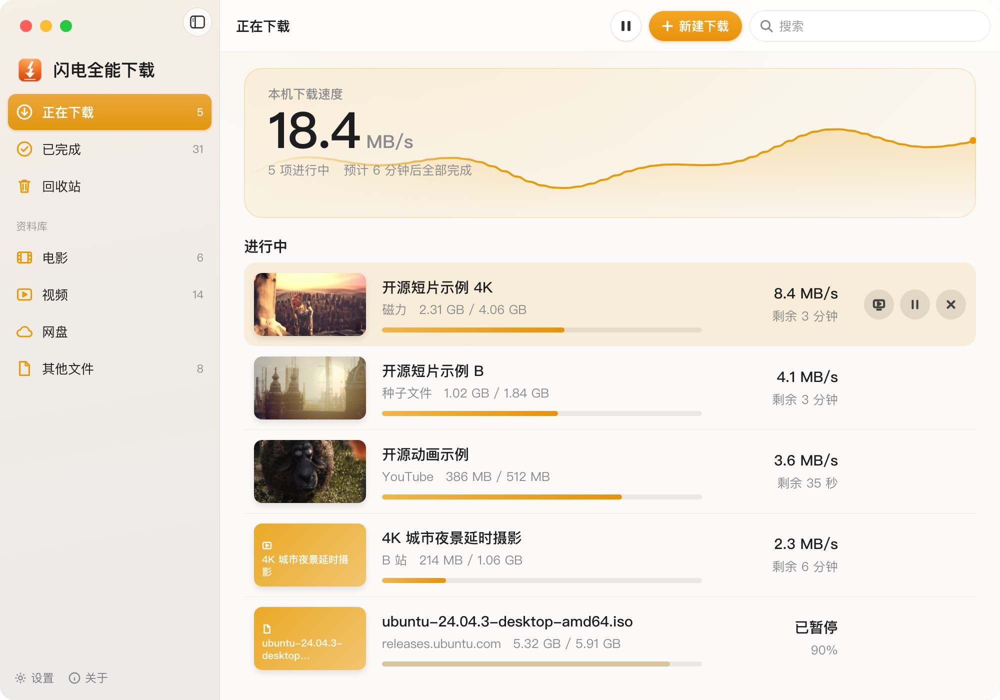

<div align="center">


# Shandian Download Manager

**Stuck at 0%? It switches to another route and finishes the download.**

A free, open-source, native macOS download manager. When BitTorrent stalls, it hands the task to cloud offline download or a local Thunder client,<br>
then moves the file back to your folder and cleans up the cloud copy

Magnet · Torrent · ed2k · Direct links · Cloud drives · YouTube, Bilibili, Douyin, Xiaohongshu, WeChat Channels

[简体中文](README.md) | English


<sub>Animation is sped up and uses sample data. Real speed depends on the source and your network.</sub>

<!-- screenshot -->

</div>

Shandian Download Manager (闪电全能下载) is an open-source download manager for the Mac. It brings magnet links, torrents, ed2k, HTTP/HTTPS files, cloud-drive direct links and video platforms together in a single window. Copy a link and press ⌘V in the window to start; the link type is detected automatically. With the companion browser extension, downloads started on web pages are handed over to Shandian.

The app is written in SwiftUI. Downloads are handled by a patched build of [Gopeed](https://github.com/GopeedLab/gopeed), and video platforms are supported through [yt-dlp](https://github.com/yt-dlp/yt-dlp).

> **Language note:** the app interface is currently available in Simplified Chinese only.

## Supported sources

| Source | How to add |
| --- | --- |
| Magnet links, torrent files, ed2k | Copy the link and press ⌘V, or drag a torrent file into the window |
| HTTP / HTTPS files | Copy the link and press ⌘V; with the browser extension installed, downloads are taken over automatically |
| YouTube, X, Bilibili, Weibo | Copy the video page URL and press ⌘V |
| Douban movie trailers | Paste the trailer-page URL |
| WeChat Channels | Paste the share link and follow the guide to use the browser extension on a signed-in Tencent Yuanbao page |
| Douyin, Xiaohongshu, Xinpianchang | Open the video page in the browser and send it via the full extension |
| Baidu Netdisk and other cloud drives | Obtain a direct link with the [LinkSwift](https://greasyfork.org/scripts/583582-linkswift) userscript (installed separately), then send it to Shandian |

Regular video sites use the highest available quality, preferring H.264 and AAC. Douyin and Xiaohongshu support watermark-free downloads. WeChat Channels uses the video returned by Yuanbao and does not currently offer quality or subtitle selection; it requires a signed-in Tencent Yuanbao session; the share link is submitted to Tencent only when you request parsing. Availability and quality depend on the site and account permissions.

## Performance

- **Fast magnet start**: fresh trackers are merged from public lists on every launch, and a fixed BT listening port makes it easier for peers to connect. In tests with public-domain films, magnet downloads started within 5–18 seconds
- **Multi-connection HTTP**: large files are split into segments of at least 20 MB and downloaded in parallel. Rate limiting (429) and temporary server errors (5xx) trigger automatic back-off; a task is only marked as failed after 3 minutes without progress
- **Concurrent video fragments**: YouTube and similar platforms are downloaded with 4 concurrent fragments; in testing this raised throughput from 1.4–1.6 MiB/s to 3.4–4.1 MiB/s
- **Cloud offline download (optional)**: resources with no active seeders can be fetched by PikPak's servers first, then pulled down from the cloud. Directories with 500 or more entries or a paginated response are not pulled until their complete contents can be confirmed; cloud folders are retained
- **Per-domain proxy routing**: follows the system proxy setting — overseas sites go through the proxy, while mainland China sites and BT traffic connect directly

> Figures above were measured on the author's network. Actual speed depends on network conditions and resource availability.

## Features

<div align="center">

</div>

- **Library**: tasks are sorted into Movies, Videos, Cloud Drive and Other Files; finished films are shown as thumbnails and open with a double-click
- **Stream while downloading**: play a film before it finishes; seeking prioritizes the corresponding pieces
- **Background and resume**: downloads continue after the window is closed, with live speed in the menu bar; unfinished tasks resume on the next launch without re-verification
- **Clipboard detection**: copying a download link in another app shows a prompt in the top-right corner — click to start
- **Settings**: separate save locations for torrents, video platforms and other files; adjustable concurrent tasks and a global speed limit
- **Trash**: removed tasks are kept in a list and can be downloaded again
- **Notifications**: a system notification and a sound when a download completes
- **Scheduled downloads**: download only during chosen hours, with automatic pause and resume
- **Chinese and English**: choose Same as System, Simplified Chinese or English in Settings; the whole interface uses one language, and the browser extension follows the browser
- **Diagnostics export**: export diagnostic information for feedback, without paths, titles, links or tokens
- **One-click update**: when a new version is out, an update button appears at the bottom of the sidebar; click it to download the build for your chip, verify and install it inside the app, which then reopens and resumes unfinished tasks

## Requirements

- macOS 14 or later
- Apple silicon (M-series) or Intel Mac — a separate package is provided for each
- ffmpeg for video platforms (used to merge audio and video; see below)

## Installation

### Option 1: one-line install (recommended)

With [Homebrew](https://brew.sh):

```bash
brew install --cask chenmozhe008/shandian/shandian
```

Video platforms also need `brew install ffmpeg`.

Without Homebrew, open Terminal, paste the command below and press Return:

```bash
curl -fsSL https://raw.githubusercontent.com/chenmozhe008/shandian-download/master/script/install.sh | bash
```

The script downloads the latest release, checks its SHA-256 when provided by GitHub, installs it in Applications, opens it, and avoids the "unidentified developer" prompt. If [Homebrew](https://brew.sh) is installed, ffmpeg is installed as well. Run the same command again to update; from 0.18.0 the app can also update itself.

### Option 2: manual install

1. Download the package for your Mac from [Releases](../../releases): `Shandian-<version>-AppleSilicon.zip` for M-series chips, `Shandian-<version>-Intel.zip` for Intel processors (see Apple menu → About This Mac). Unzip it and drag the app into Applications
2. On first launch macOS will report that it cannot verify the developer (the app is not notarized). Click Done, open **System Settings → Privacy & Security**, and click **Open Anyway** near the bottom. Subsequent launches work normally
3. For video platforms, install ffmpeg: `brew install ffmpeg`

Controlling Thunder automatically requires Accessibility permission: allow Shandian in System Settings → Privacy & Security → Accessibility. If it is already on, turn it off and on again.

Updates come from GitHub, and PikPak and some video sites are hosted overseas. In regions where they are blocked, you need a VPN or proxy; the app shows a message when it can't reach them.

## Browser extension

There are two versions, both for Chrome and Edge. Pick one:

| | Full version (more features, recommended) | Store version (easy install) |
|---|---|---|
| Install | Manual, with Developer mode on | Search in the browser's store, one click |
| Updates | With the app | Through the browser's store |
| Right-click to send archive, document and installer links | ✓ | ✓ |
| Take over downloads started on web pages | ✓ | ✓ (from 0.2.0, files over 5 MB) |
| Magnet and ed2k links | ✓ | — |
| Clicked torrent files go straight to the app | ✓ | — |
| A Download button over videos on video sites | ✓ | — |
| Douyin, Xiaohongshu, Xinpianchang and other videos | ✓ | — |
| WeChat Channels | ✓ | — |
| Grab links from a page in bulk | ✓ | — |
| Links that require sign-in | ✓ | May not work |
| Browser permissions | All sites, cookies and downloads | Context menu, downloads, local settings and connecting to the app only |

### Store version

Search for **Shandian Download Manager** in the Chrome Web Store or Edge Add-ons, or open it directly: [Chrome](https://chromewebstore.google.com/detail/achpnnoffkoeomkmofbcjpnmifaeanjg) · [Edge](https://microsoftedge.microsoft.com/addons/detail/onnpjcddpnfmaahjjdcibcofebfgopei).

Right-click a supported file link and choose **发送到闪电 / Send to Shandian**. From 0.2.0, downloads over 5 MB started on web pages also go to Shandian automatically; turn this off in the extension popup. When Shandian isn't open, the browser downloads as usual. Shandian (0.18.24 or later) must be open.

### Full version

1. In the menu bar choose **闪电全能下载 → 浏览器扩展…** (Browser Extension), then click **手动安装** (Install manually) in the row of your browser. This opens the extensions page and the extension folder
2. Turn on **Developer mode** (top-right in Chrome, left sidebar in Edge)
3. Drag the `BrowserExtension` folder onto the extensions page

Once installed, the window shows **已连接** (Connected).

## For AI Tools (MCP)

The app includes an MCP server, so AI tools can add downloads, check progress, pause and resume. It runs only on your Mac and can't delete tasks or files. Go to Settings → AI Tools, choose a tool and copy its command or config:

| Tool | How to connect |
|---|---|
| Claude Code, Codex, Gemini CLI | Run the copied command in Terminal |
| ChatGPT desktop app | Settings → MCP servers → Add server, choose STDIO, paste the copied path as the command |
| Claude Desktop | Settings → Developer → Edit Config, then paste |
| Cursor | Paste into `~/.cursor/mcp.json` |
| Trae | Settings → MCP → Add Manually |
| Windsurf | Open the config file from Cascade's MCP menu |
| VS Code | Run `MCP: Open User Configuration` from the Command Palette |
| Other MCP tools | Use the generic `mcpServers` config |

## License

[GPL-3.0](LICENSE). Download only content you have the right to obtain, and follow each site's terms of service and applicable law. Films shown in the screenshots are public-domain or open-source works; the interface data is for demonstration.
