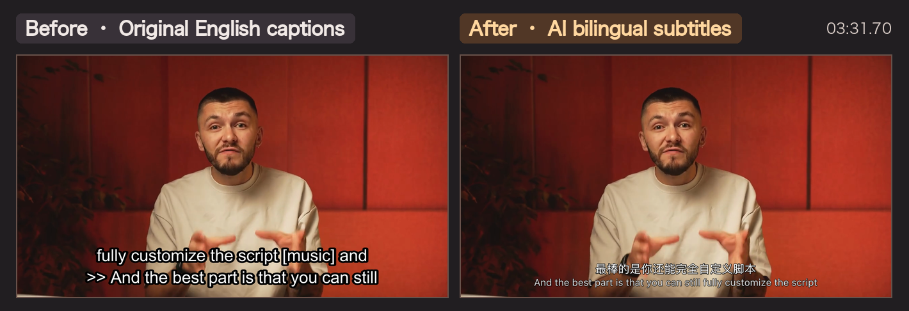
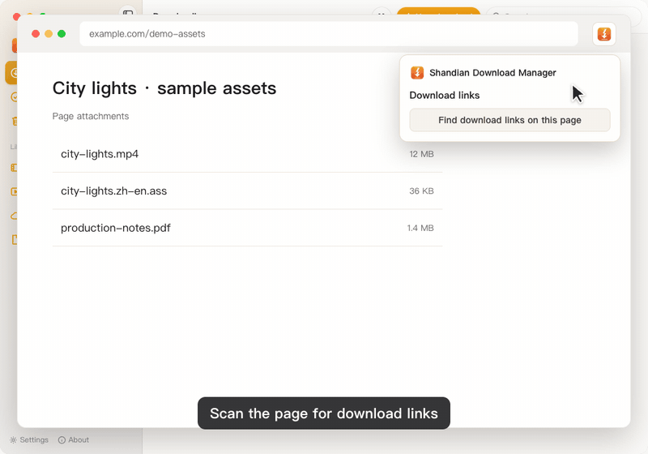
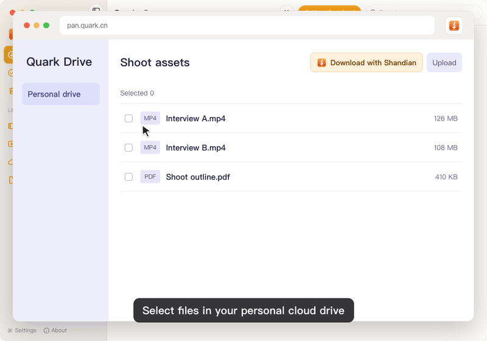

<div align="center">


# Shandian Download Manager

**Free, ad-free, open-source download manager for macOS & Windows**

Built to be **fast** (multi-connection HTTP, mirror racing, stalled-BT auto-rescue) and **versatile** (torrents, 4K video with bilingual subtitles, 4 cloud drives, Feishu Docs, and web media — all in one app).

[**Download Mac (Apple Silicon)**](https://github.com/chenmozhe008/shandian-download/releases/download/v0.22.8/Shandian-0.22.8-AppleSilicon.zip) · [**Download Mac (Intel)**](https://github.com/chenmozhe008/shandian-download/releases/download/v0.22.8/Shandian-0.22.8-Intel.zip) · [**Download Windows (x64)**](https://github.com/cgeek-dev/shandian-download/releases/download/v0.2.23-windows/Shandian-0.2.23-Windows-x64-setup.exe) · [Quick Install](#quick-install) · [简体中文](README.md)

[](https://github.com/chenmozhe008/shandian-download/releases/latest)
[](LICENSE)


<br>


</div>

---

## Features

- **Downloads almost everything — including the hard ones**: Alongside magnet links, `.torrent` files, ed2k, and HTTP direct links, Shandian handles **YouTube, Bilibili, Douyin, Xiaohongshu (watermark-free), WeChat Channels**, **Baidu / Aliyun / Quark / UC Drives**, **Feishu & Qingque Docs original media**, and **hidden web audio/video sniffing** — all managed in one app.
- **Fast by default, even on stalled torrents**: Multi-connection HTTP chunking, 4-way concurrent video fragments, automatic mirror racing for **GitHub & Hugging Face** with failover resume, fresh BitTorrent trackers with a fixed port, and automatic route switching to local Thunder or PikPak cloud offline when a torrent stalls at 0%.
- **4K video with clean bilingual ASS subtitles**: Automatically saves video and subtitles into a dedicated folder. AI mode re-segments fragmented YouTube captions, keeps terminology consistent across the video, and writes a single styled bilingual `.ass` file ready to play without track conflicts.
- **One-click browser extension**: Click once in Chrome or Edge to send videos, cloud drive files, Feishu/Qingque attachments, sniffed web audio (with waveform preview), or bulk page links straight to Shandian.
- **Native on macOS & Windows**: Built with **SwiftUI on macOS** and **Tauri on Windows** (independently maintained by [@cgeek-dev](https://github.com/cgeek-dev)). Includes auto-sorted libraries, stream-while-downloading, scheduled downloads, collection drawers, and one-click updates — completely free and ad-free.

---

## Quick Install

### Option 1: Install via an AI Assistant (Recommended)

Send the prompt for your OS to Claude Code, Codex, Cursor, or any terminal-capable AI assistant:

**For macOS:**

> Please install Shandian Download Manager (https://github.com/chenmozhe008/shandian-download) by running `curl -fsSL https://raw.githubusercontent.com/chenmozhe008/shandian-download/master/script/install.sh | bash` in Terminal, then guide me step-by-step to install its Chrome/Edge browser extension.

**For Windows:**

> Please install Shandian Download Manager for Windows (https://github.com/cgeek-dev/shandian-download/releases/latest): download and run the latest `Shandian-*-Windows-x64-setup.exe` installer, then guide me step-by-step to install its Chrome/Edge browser extension.

### Option 2: Command Line (macOS)

With Homebrew:

```bash
brew install --cask chenmozhe008/shandian/shandian
brew install ffmpeg   # required for merging video & audio streams
```

Without Homebrew (auto-detects chip, verifies SHA-256, installs, and avoids the first-launch Gatekeeper prompt):

```bash
curl -fsSL https://raw.githubusercontent.com/chenmozhe008/shandian-download/master/script/install.sh | bash
```

### Option 3: Manual Download

- **macOS (14 or later)**: Download [AppleSilicon.zip](https://github.com/chenmozhe008/shandian-download/releases/download/v0.22.8/Shandian-0.22.8-AppleSilicon.zip) for M-series chips or [Intel.zip](https://github.com/chenmozhe008/shandian-download/releases/download/v0.22.8/Shandian-0.22.8-Intel.zip) for Intel Macs, then drag the app into Applications. On first launch, click **Done**, open **System Settings → Privacy & Security**, and click **Open Anyway**. Install `ffmpeg` (`brew install ffmpeg`) for video sites.
- **Windows (10 / 11 x64)**: Download the [Windows Installer (v0.2.23)](https://github.com/cgeek-dev/shandian-download/releases/download/v0.2.23-windows/Shandian-0.2.23-Windows-x64-setup.exe) or [Portable ZIP](https://github.com/cgeek-dev/shandian-download/releases/download/v0.2.23-windows/Shandian-0.2.23-Windows-x64-Portable.zip). See [windows/README.md](windows/README.md) and [windows/CHANGELOG.md](windows/CHANGELOG.md) for details.

### Chrome / Edge Extension

- **Full version (recommended — unlocks video, cloud drives, docs & sniffing)**: Open the **Browser Extension** guide inside Shandian, click **Install manually**, enable **Developer mode** in your browser, and drag the `BrowserExtension` folder onto the extensions page. Updates automatically with the app.
- **Store version (one-click install for direct links & torrents)**: [Chrome Web Store](https://chromewebstore.google.com/detail/achpnnoffkoeomkmofbcjpnmifaeanjg) · [Edge Add-ons](https://microsoftedge.microsoft.com/addons/detail/onnpjcddpnfmaahjjdcibcofebfgopei)

| Capability | Full (Recommended) | Store |
| --- | :---: | :---: |
| Right-click send & auto-takeover for web downloads (5 MB+) | ✓ | ✓ |
| Clicked `.torrent` files sent straight to Shandian | ✓ | ✓ |
| Magnet & ed2k link takeover | ✓ | — |
| Video page Download button (YouTube, Douyin, Xiaohongshu, Xinpianchang, WeChat Channels) | ✓ | — |
| Aliyun / Quark / UC Drive toolbar download button | ✓ | — |
| Web audio/video sniffing, waveform preview & bulk saving | ✓ | — |
| Feishu & Qingque Docs original media scan & batch download | ✓ | — |
| Bulk page link extraction | ✓ | — |

---

## Screenshots & Demos

### 1. Video Downloads & Bilingual Subtitles

When subtitles are enabled, Shandian creates a dedicated folder for each video. With **AI translation (Bilingual)** selected, it re-segments fragmented YouTube captions into full sentences, extracts a consistent terminology glossary, and writes a single cleanly styled bilingual **`.ass`** file (Chinese primary line on top, smaller original text below) so players like IINA, VLC, and Infuse display it cleanly out of the box without track conflicts.

<div align="center">


<sub>Real comparison at 03:31.70: overlapping raw captions on the left vs. re-segmented bilingual ASS on the right (<a href="https://www.youtube.com/watch?v=X0yezvS3zR4&t=211s">sample video</a> · <a href="https://raw.githubusercontent.com/chenmozhe008/shandian-download/master/docs/images/workflow-video-en.mp4">watch 14s demo</a>)</sub>
</div>

- Works with **local Ollama (free & offline)** as well as DeepSeek, Kimi, Qwen, Doubao, GLM, OpenAI, Gemini, and Claude; **Test Connection** fetches the latest model list at zero cost.
- Also supports **Original subtitles only** (local cleanup, no AI) and **Audio only (M4A)**.

### 2. Automatic Route Switching for Stalled Torrents

When a magnet or BitTorrent task has no active peers and stalls at 0%, Shandian hands it off to a local Thunder client or PikPak cloud offline download, pulls the completed files back to your save folder, and cleans up temporary cloud copies automatically.

<div align="center">

</div>

### 3. Web Media Sniffing, Document Attachments & Bulk Links

- **Web audio & video sniffing**: Enable detection in the extension, press play, preview captured items with a waveform, and save with original filenames.
- **Feishu & Qingque Docs**: Scan full documents for original audio/video attachments and batch-save them into one folder.
- **Bulk link extraction**: Scan any page for MP4, MP3, ZIP, magnet, and ed2k links and queue selected items in one click.

<div align="center">

</div>

### 4. Auto-Sorted Library, Stream While Downloading & Windows UI

Completed tasks are organized into Movies, Videos, Cloud Drive, and Other Files, with **stream-while-downloading**, multi-select batch actions, folder drawers, and menu-bar / tray speed monitoring.

<div align="center">

</div>

| Windows · Bilingual ASS Style Preview | Windows · Collection & Subtitle Status |
| :---: | :---: |
|  |  |

<div align="center">

</div>

### 5. Batch Downloads from a Cloud Drive

In this Quark Drive example, select two files and click **Download with Shandian** in the toolbar to send both to the queue. Personal drives on Aliyun and UC offer the same entry point with the full Chrome / Edge extension.

<div align="center">


<sub>Cloud drive batch-download demonstration with sample files</sub>
</div>

---

## Supported Sources

### Video & Subtitles

| Source | How to Add |
| --- | --- |
| YouTube, Bilibili, X, Weibo, Douban trailers, Xigua, Kuaishou, Vimeo | Copy & paste or send via the browser extension; highest quality by default (H.264 / AAC preferred) |
| Douyin, Xiaohongshu, Xinpianchang | Open the video page and click **Download this video** in the full extension (watermark-free where available) |
| WeChat Channels | Paste the share link and follow the prompt to parse via the full extension on a signed-in Tencent Yuanbao page |

### Cloud Drives (No Desktop Client Needed)

| Source | How to Add |
| --- | --- |
| Baidu Netdisk shares | Paste share link + access code; authorize official [bdpan](https://github.com/baidu-netdisk/bdpan-storage) once, then save locally with auto cloud cleanup |
| Aliyun Drive, Quark Drive, UC Drive | Select files in the web drive and click the **Download with Shandian** toolbar button injected by the full extension |
| Other direct cloud links | Paste direct links directly or send via [LinkSwift](https://github.com/hmjz100/LinkSwift) |

[Watch the cloud drive batch-download demo](#5-batch-downloads-from-a-cloud-drive)

### Protocols & Open Source

| Source | How to Add |
| --- | --- |
| Magnet links, `.torrent` files, ed2k, HTTP / HTTPS direct links | Paste, drag in `.torrent` files, or let the extension take over browser downloads |
| GitHub & Hugging Face public files | Paste the URL to automatically race public mirrors and resume seamlessly on failover |

### Docs & Web Media

| Source | How to Add |
| --- | --- |
| Feishu Docs & Wiki media | Open the full extension on the doc or paste the doc URL (requires authorized official [lark-cli](https://github.com/larksuite/cli)) |
| Qingque Docs media | Click **Scan Current Page** in the full extension to batch-save original audio/video attachments |
| Web audio/video & page links | Use **Detect Media on This Page** or **Scan Page for Download Links** in the full extension |

---

## Performance

- **Fast magnet start**: Merges fresh public trackers on launch with a fixed BitTorrent listening port (5–18s start on public-domain test torrents).
- **Multi-connection HTTP**: Splits large files into parallel chunks (≥ 20 MB each) with automatic backoff on HTTP 429 / 5xx.
- **4-way concurrent video fragments**: Raises YouTube throughput from 1.4–1.6 MiB/s to 3.4–4.1 MiB/s in testing.
- **Per-domain proxy routing**: Follows system proxy settings — overseas sites use the proxy while mainland China sites and BT traffic connect directly.
- **PikPak cloud offline (optional)**: Sign in with a free [PikPak](https://mypikpak.com) account in **Settings → Download Acceleration** (~3 tasks / 20 GB daily quota); stalled BT tasks auto-hand-off after 1–3 minutes and clean up temporary cloud copies once retrieved.

---

## FAQ

- **macOS "Unidentified developer" warning**: Use the one-line installer above, or allow it once in **System Settings → Privacy & Security → Open Anyway**.
- **Video has no audio / merge failed**: Install `ffmpeg` (`brew install ffmpeg`).
- **YouTube / updates / PikPak unreachable**: Enable your system proxy or VPN (Shandian follows system proxy settings automatically).
- **Cannot control local Thunder**: Enable Shandian under **System Settings → Privacy & Security → Accessibility** (toggle off and on if already enabled).
- **Change default save folders**: Configure separate folders for torrents, video sites, and other files under **Settings → General**.

---

## Advanced: Local MCP & Building from Source

### Built-in Local MCP (Optional)

Shandian ships a local-only MCP server so AI tools can add downloads, inspect progress, pause, and resume — **without ever deleting tasks or local files**. Copy the ready-made config from **Settings → AI Tools**:

| AI Tool | Setup |
| --- | --- |
| **Claude Code / Codex / Gemini CLI** | Run the copied command in Terminal |
| **ChatGPT Desktop** | Settings → MCP servers → Add server (STDIO), paste the copied command path |
| **Claude Desktop / Cursor / VS Code / Trae / Windsurf** | Paste the generated `mcpServers` JSON into your MCP config |

### Building from Source

- **macOS**:
  ```bash
  swift build -c release          # Build SwiftUI app
  ./script/build_engine.sh        # Build patched Gopeed v1.9.3 engine (requires Go)
  ./script/build_app.sh package   # Package dist/闪电全能下载.app
  ```
  The patched engine diff lives in `engine/shandian-gopeed-v1.9.3.patch` (skip re-verification on relaunch, global speed limit, stream-while-downloading, HTTP backoff/retry). Adjust local paths in the build scripts for your machine.
- **Windows**: See [windows/README.md](windows/README.md).

---

## Credits & License

- **Credits**: [@cgeek-dev](https://github.com/cgeek-dev) (Windows edition) · [Gopeed](https://github.com/GopeedLab/gopeed) (download engine) · [yt-dlp](https://github.com/yt-dlp/yt-dlp) (video extraction) · [FFmpeg](https://ffmpeg.org) (muxing)
- **Notice**: Download only content you have the right to access, and follow each site's terms of service and applicable laws. Availability, quality, subtitle tracks, and speeds depend on the target service and your network. When using an online AI subtitle provider, subtitle text is sent to the provider you configure. Screenshots and demos use sample data.
- **License**: [GPL-3.0](LICENSE)
