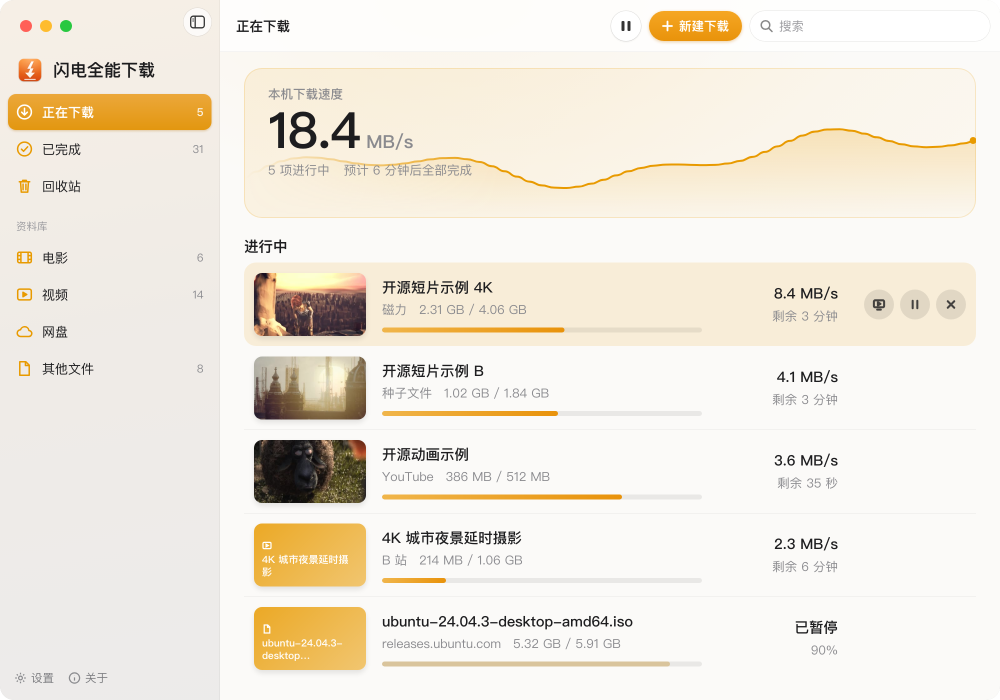

<div align="center">


# Shandian Download Manager

<strong>Fast, clean open-source download manager for macOS &amp; Windows.</strong>

Manage magnet links, torrents, ed2k, HTTP direct links, cloud drive shares, video platforms, and web media in one window.<br>
Multi-connection acceleration with automatic route switching when BitTorrent stalls.

Magnet · Torrent · ed2k · Direct links · Baidu Netdisk shares · Feishu and Qingque document media · Bulk web downloads · YouTube, Bilibili, Douyin, Xiaohongshu, WeChat Channels

[macOS Apple Silicon](https://github.com/chenmozhe008/shandian-download/releases/download/v0.22.6/Shandian-0.22.6-AppleSilicon.zip) · [macOS Intel](https://github.com/chenmozhe008/shandian-download/releases/download/v0.22.6/Shandian-0.22.6-Intel.zip) · [Windows (x64)](#windows-edition) · [Release notes](https://github.com/chenmozhe008/shandian-download/releases/latest)

[简体中文](README.md) | English

[](https://github.com/chenmozhe008/shandian-download/releases/latest)


<!-- screenshot -->

</div>

Shandian Download Manager is a free, open-source download manager for **macOS and Windows** that handles magnet links, torrents, ed2k, HTTP/HTTPS files, Baidu Netdisk shares, and video platforms in a single window. Copy a link and paste it to start; with the Chrome / Edge extension, you can also batch-extract downloadable links, capture and preview web audio and video, and save original media attachments from Feishu and Qingque Docs (single files save directly; multiple files are grouped into one folder).

The macOS edition is maintained in this repository (Simplified Chinese & English), while the Windows edition is independently developed and maintained by [@cgeek-dev](https://github.com/cgeek-dev). Downloads are powered by a customized [Gopeed](https://github.com/GopeedLab/gopeed) engine, with video platform support from [yt-dlp](https://github.com/yt-dlp/yt-dlp).

## Highlights

- <strong>Unified download management</strong>: Magnet links, torrents, ed2k, direct links, cloud drive shares, and video sites in one window, with clipboard detection and browser download takeover
- <strong>Multi-connection acceleration</strong>: Parallel HTTP chunks, 4-way concurrent video segments, fresh public trackers with a fixed BitTorrent port, and per-domain proxy routing
- <strong>Document media downloads</strong>: Scan Feishu and Qingque Docs for original audio and video attachments, select what you need, and keep original filenames (multiple items save into one folder)
- <strong>Web link &amp; media capture</strong>: Batch-extract downloadable links from web pages, or capture playing audio and video with waveform preview and selective saving
- <strong>Direct Baidu Netdisk share downloads</strong>: Paste a share link and access code; after initial authorization, save directly to your computer without installing the Baidu Netdisk desktop client, with automatic cloud transfer cleanup once verified
- <strong>Automatic route switching for stalled torrents</strong>: When a BitTorrent or magnet task stalls at 0%, hand it over to a local Thunder client or PikPak cloud offline download, then move the file back and clean up temporary copies
- <strong>Lightweight &amp; MCP-ready</strong>: Stream while downloading, schedule download hours, and remember save folders by category; includes a built-in local MCP server for Claude Code, Codex, Cursor, ChatGPT Desktop, and other MCP clients

## Supported sources

| Source | How to add |
| --- | --- |
| Magnet links, torrent files, ed2k | Copy and paste the link, or drag a torrent file into the window |
| HTTP / HTTPS files | Copy and paste the link; with the browser extension installed, web downloads are taken over automatically |
| YouTube, X, Bilibili, Weibo | Copy and paste the video page URL |
| Douban movie trailers | Copy and paste the trailer-page URL |
| WeChat Channels | Paste the share link and follow the guide to use the browser extension on a signed-in Tencent Yuanbao page |
| Web audio & video | Turn on “Detect Media on This Page” in the full extension, play to capture, preview with waveform, save with original names, or save multiple files to one folder |
| Direct file links, including MP4, MP3 and ZIP | Scan the current page for downloadable links in the full extension, select items and add them in bulk |
| Douyin, Xiaohongshu, Xinpianchang | Open the video page in the browser and send it via the full extension |
| Baidu Netdisk shares | Paste a share link and an access code if needed. Choose “Download with Shandian” after setting up the [official bdpan tool](https://github.com/baidu-netdisk/bdpan-storage), or open the share page |
| Feishu document audio and video | Open the full extension on the document to choose attachments, or paste the document link into Shandian to download all attachments. Requires Feishu’s official lark-cli and authorization |
| Qingque Docs audio and video | Choose Scan Current Page in the full extension and select accessible original attachments |
| Cloud storage direct links | Obtain a direct link with [LinkSwift](https://github.com/hmjz100/LinkSwift) and send it to Shandian |

Regular video sites use the highest available quality, preferring H.264 and AAC. Douyin and Xiaohongshu support watermark-free downloads. WeChat Channels uses the video returned by Yuanbao and does not currently offer quality or subtitle selection; it requires a signed-in Tencent Yuanbao session; the share link is submitted to Tencent only when you request parsing. Availability and quality depend on the site and account permissions.

For Baidu Netdisk shares, bdpan saves a copy in your authorized account's app data folder before downloading it. Follow Baidu's setup and authorization instructions the first time. Shandian shows bytes transferred, speed, and percentage when a total size is available. After verifying the local files, Shandian removes the temporary cloud copy. The transfer folder is under My Application Data → bdpan → Shandian. Cloud storage, permissions and transfer speed depend on Baidu Netdisk. Baidu blocks saving your own shares back to the same account. In that case, open the official share page or find the original in Netdisk.

## Performance

- <strong>Fast magnet start</strong>: fresh trackers are merged from public lists on every launch, and a fixed BT listening port makes it easier for peers to connect. In tests with public-domain films, magnet downloads started within 5–18 seconds
- <strong>Multi-connection HTTP</strong>: large files are split into segments of at least 20 MB and downloaded in parallel. Rate limiting (429) and temporary server errors (5xx) trigger automatic back-off; a task is only marked as failed after 3 minutes without progress
- <strong>Concurrent video fragments</strong>: YouTube and similar platforms are downloaded with 4 concurrent fragments; in testing this raised throughput from 1.4–1.6 MiB/s to 3.4–4.1 MiB/s
- <strong>Cloud offline download (optional)</strong>: resources with no active seeders can be fetched by PikPak's servers first, then pulled down from the cloud. Directories with 500 or more entries or a paginated response are not pulled until their complete contents can be confirmed; cloud folders are retained
- <strong>Per-domain proxy routing</strong>: follows the system proxy setting — overseas sites go through the proxy, while mainland China sites and BT traffic connect directly

> Figures above were measured on the author's network. Actual speed depends on network conditions and resource availability.

## Features

<div align="center">

</div>

- <strong>Library</strong>: tasks are sorted into Movies, Videos, Cloud Drive and Other Files; finished films are shown as thumbnails and open with a double-click
- <strong>Stream while downloading</strong>: play a film before it finishes; seeking prioritizes the corresponding pieces
- <strong>Background and resume</strong>: downloads continue after the window is closed, with live speed in the menu bar; unfinished tasks resume on the next launch without re-verification
- <strong>Clipboard detection</strong>: copying a download link in another app shows a prompt in the top-right corner — click to start
- <strong>Settings</strong>: separate save locations for torrents, video platforms and other files; adjustable concurrent tasks and a global speed limit
- <strong>Trash</strong>: removed tasks are kept in a list and can be downloaded again
- <strong>Notifications</strong>: a system notification and a sound when a download completes
- <strong>Scheduled downloads</strong>: download only during chosen hours, with automatic pause and resume
- <strong>Chinese and English</strong>: choose Same as System, Simplified Chinese or English in Settings; the whole interface uses one language, and the browser extension follows the browser
- <strong>Diagnostics export</strong>: export diagnostic information for feedback, without paths, titles, links or tokens
- <strong>One-click update</strong>: when a new version is out, an update button appears at the bottom of the sidebar; click it to download the build for your chip, verify and install it inside the app, which then reopens and resumes unfinished tasks

## Requirements

- **macOS**: macOS 14 or later (separate Apple silicon and Intel builds); `ffmpeg` is required for video platforms
- **Windows**: Windows 10 / 11 (x64, Simplified Chinese UI), maintained by [@cgeek-dev](https://github.com/cgeek-dev) — see [Windows edition](#windows-edition) below

## Installation (macOS)

### Option 1: one-line install (recommended)

With [Homebrew](https://brew.sh):

```bash
brew install --cask chenmozhe008/shandian/shandian
```

Video platforms also need `brew install ffmpeg`.

Without Homebrew, open Terminal, paste the command below and press Return:

```bash
curl -fsSL https://raw.githubusercontent.com/chenmozhe008/shandian-download/master/script/install.sh | bash
```

The script downloads the latest release, checks its SHA-256 when provided by GitHub, installs it in Applications, opens it, and avoids the "unidentified developer" prompt. If [Homebrew](https://brew.sh) is installed, ffmpeg is installed as well. Run the same command again to update; from 0.18.0 the app can also update itself.

### Option 2: manual install

1. Download the package for your Mac from [Releases](../../releases): `Shandian-<version>-AppleSilicon.zip` for M-series chips, `Shandian-<version>-Intel.zip` for Intel processors (see Apple menu → About This Mac). Unzip it and drag the app into Applications
2. On first launch macOS will report that it cannot verify the developer (the app is not notarized). Click Done, open <strong>System Settings → Privacy & Security</strong>, and click <strong>Open Anyway</strong> near the bottom. Subsequent launches work normally
3. For video platforms, install ffmpeg: `brew install ffmpeg`

Controlling Thunder automatically requires Accessibility permission: allow Shandian in System Settings → Privacy & Security → Accessibility. If it is already on, turn it off and on again.

Updates come from GitHub, and PikPak and some video sites are hosted overseas. In regions where they are blocked, you need a VPN or proxy; the app shows a message when it can't reach them.

## Windows edition

The Windows edition (Windows 10 / 11, x64, Simplified Chinese UI) is independently developed and maintained by [@cgeek-dev](https://github.com/cgeek-dev), with its source code hosted in [`windows/`](windows/).

- **Download**: [Latest Windows Release](https://github.com/cgeek-dev/shandian-download/releases/latest) (installer & portable builds, with built-in auto-update)
- **Docs & Changelog**: [windows/README.md](windows/README.md) · [windows/CHANGELOG.md](windows/CHANGELOG.md)

It keeps the same interface and core features as the macOS edition, and adds extra cloud drive link extraction, GitHub / Hugging Face mirror acceleration, and local Ollama subtitle polishing. Windows releases and issues are maintained by [@cgeek-dev](https://github.com/cgeek-dev/shandian-download).

## Browser extension

There are two versions, both for Chrome and Edge. Pick one:

| | Full version (more features, recommended) | Store version (easy install) |
|---|---|---|
| Install | Manual, with Developer mode on | Search in the browser's store, one click |
| Updates | With the app | Through the browser's store |
| Right-click to send archive, document and installer links | ✓ | ✓ |
| Take over downloads started on web pages | ✓ | ✓ (from 0.2.0, files over 5 MB) |
| Magnet and ed2k links | ✓ | — |
| Clicked torrent files go straight to the app | ✓ | ✓ (from 0.2.0) |
| A Download button over videos on video sites | ✓ | — |
| Douyin, Xiaohongshu, Xinpianchang and other videos | ✓ | — |
| WeChat Channels | ✓ | — |
| Web audio & video detection, preview and bulk saving | ✓ | — |
| Scan and select audio and video in Feishu and Qingque Docs | ✓ | — |
| Grab links from a page in bulk | ✓ | — |
| Links that require sign-in | ✓ | May not work |
| Browser permissions | All sites, cookies and downloads | Context menu, downloads, local settings and connecting to the app only |

### Store version

Search for <strong>Shandian Download Manager</strong> in the Chrome Web Store or Edge Add-ons, or open it directly: [Chrome](https://chromewebstore.google.com/detail/achpnnoffkoeomkmofbcjpnmifaeanjg) · [Edge](https://microsoftedge.microsoft.com/addons/detail/onnpjcddpnfmaahjjdcibcofebfgopei).

Right-click a supported file link and choose <strong>发送到闪电 / Send to Shandian</strong>. From 0.2.0, downloads over 5 MB started on web pages also go to Shandian automatically; turn this off in the extension popup. When Shandian isn't open, the browser downloads as usual. Shandian (0.18.24 or later) must be open.

### Full version

1. In the menu bar choose <strong>闪电全能下载 → 浏览器扩展…</strong> (Browser Extension), then click <strong>手动安装</strong> (Install manually) in the row of your browser. This opens the extensions page and the extension folder
2. Turn on <strong>Developer mode</strong> (top-right in Chrome, left sidebar in Edge)
3. Drag the `BrowserExtension` folder onto the extensions page

Once installed, the window shows <strong>已连接</strong> (Connected).

<strong>Detect web audio & video</strong>: Open the extension on a media page, click <strong>Detect Media on This Page</strong>, and play the audio or video. Reopen the extension to preview with a waveform, download single files with their original names, or save multiple downloadable files together in one folder.

<strong>Download web files in bulk</strong>: On a supported web page, choose <strong>Scan Page for Download Links</strong> and select direct links with supported extensions such as MP4, MP3 and ZIP, or magnet and ed2k links. Use <strong>Detect Media on This Page</strong> for audio or video that only loads when you press play. Download availability depends on the resources the page exposes and your account permissions.

#### Document audio and video downloads

<strong>Feishu Docs and Wiki</strong>: Open the full extension on the document to list original attachments, their sizes and the selection count. All items start selected. You can also paste the document link into Shandian to download all attachments. Install and authorize [Feishu’s official lark-cli](https://github.com/larksuite/cli) with an account that can access the document and download its attachments.

<strong>Qingque Docs</strong>: Open an accessible document and choose Scan Current Page in the full extension. It lists up to 100 original audio and video attachments per scan, including items outside the visible area.

Save one original directly or save several together in a document folder. Bulk downloads show completed file count and speed, and can reuse verified files on retry.

## For AI Tools (MCP)

The app includes an MCP server, so AI tools can add downloads, check progress, pause and resume. It runs only on your Mac and can't delete tasks or files. Go to Settings → AI Tools, choose a tool and copy its command or config:

| Tool | How to connect |
|---|---|
| Claude Code, Codex, Gemini CLI | Run the copied command in Terminal |
| ChatGPT desktop app | Settings → MCP servers → Add server, choose STDIO, paste the copied path as the command |
| Claude Desktop | Settings → Developer → Edit Config, then paste |
| Cursor | Paste into `~/.cursor/mcp.json` |
| Trae | Settings → MCP → Add Manually |
| Windsurf | Open the config file from Cascade's MCP menu |
| VS Code | Run `MCP: Open User Configuration` from the Command Palette |
| Other MCP tools | Use the generic `mcpServers` config |

## License

[GPL-3.0](LICENSE). Download only content you have the right to obtain, and follow each site's terms of service and applicable law. Films shown in the screenshots are public-domain or open-source works; the interface data is for demonstration.
