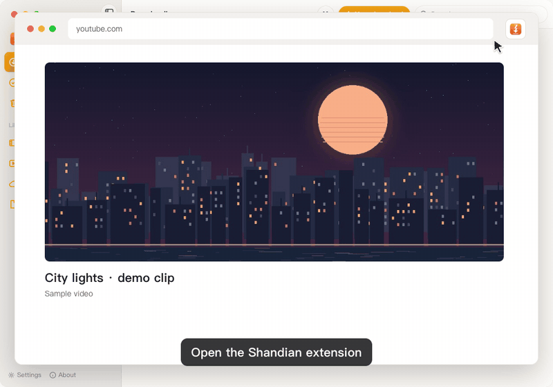
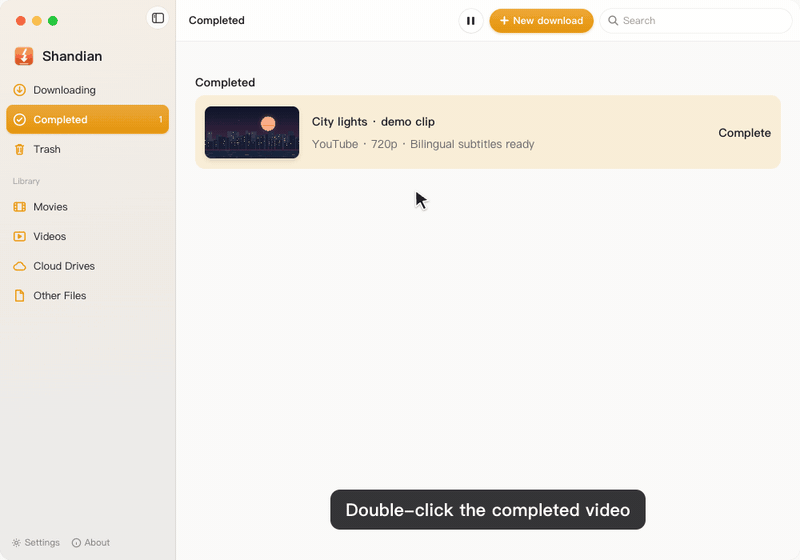
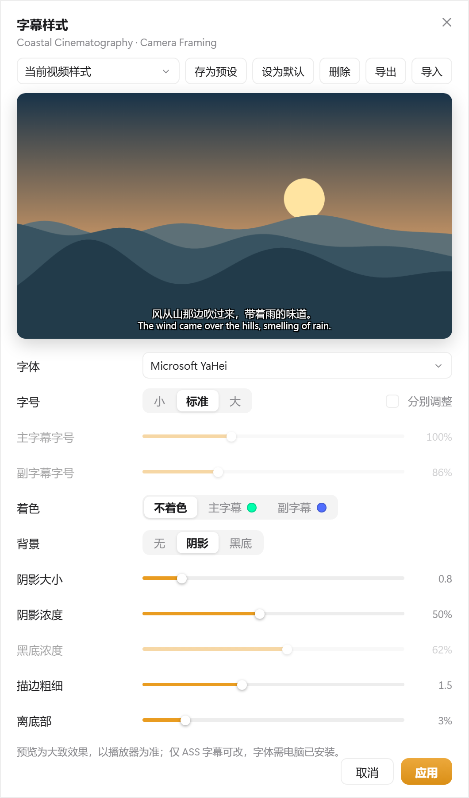
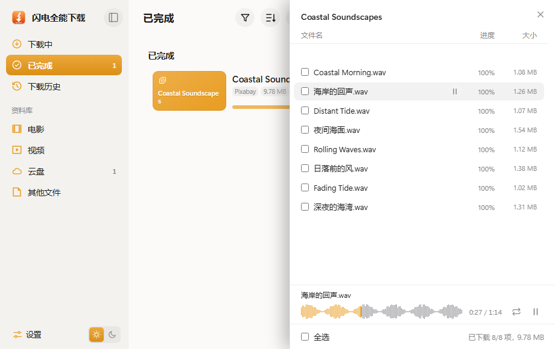

<div align="center">


# Shandian Download Manager

**Fast, ad-free, open-source all-in-one download manager for macOS & Windows**

Magnet / BitTorrent / ed2k, 4K video with bilingual subtitles, cloud drives, Feishu Docs media, and GitHub / Hugging Face mirror acceleration — all in one native window.

[**Download Mac (Apple Silicon)**](https://github.com/chenmozhe008/shandian-download/releases/download/v0.22.8/Shandian-0.22.8-AppleSilicon.zip) · [**Download Mac (Intel)**](https://github.com/chenmozhe008/shandian-download/releases/download/v0.22.8/Shandian-0.22.8-Intel.zip) · [**Download Windows (x64)**](https://github.com/cgeek-dev/shandian-download/releases/download/v0.2.23-windows/Shandian-0.2.23-Windows-x64-setup.exe) · [Quick Install](#quick-install) · [简体中文](README.md)

[](https://github.com/chenmozhe008/shandian-download/releases/latest)
[](LICENSE)


<br>


</div>

---

## Why Shandian

- **One app instead of five**: Handle magnet links, torrents, ed2k, HTTP direct links, major video platforms, Baidu / Aliyun / Quark / UC Drives, Feishu & Qingque Docs media, and GitHub / Hugging Face files in a single window.
- **Multi-connection speed & stalled-BT rescue**: Parallel HTTP chunking, 4-way concurrent video segments, automatic mirror racing for GitHub / Hugging Face with seamless failover, and automatic route switching to local Thunder or PikPak cloud offline when BitTorrent stalls at 0%.
- **4K video with clean bilingual ASS subtitles**: Automatically saves video and subtitles into a dedicated folder; AI translation re-segments broken YouTube captions, builds a per-video terminology glossary, and outputs a single styled bilingual `.ass` file ready for immediate playback.
- **No bloated cloud clients + web media sniffing**: Download directly from four major cloud drives without installing desktop clients; use the Chrome / Edge extension to sniff and preview web audio/video with waveforms, grab links in bulk, or save original Feishu / Qingque document media.
- **Native feel & built-in local MCP**: Built natively with SwiftUI on macOS and Tauri on Windows (independently maintained by [@cgeek-dev](https://github.com/cgeek-dev)). Supports stream-while-downloading, auto-sorted library, scheduled downloads, one-click updates, and a local MCP server for Claude Code, Codex, Cursor, and ChatGPT Desktop.

---

## Quick Install

### macOS (14 or later)

**Homebrew (recommended)**

```bash
brew install --cask chenmozhe008/shandian/shandian
brew install ffmpeg   # required for merging video & audio streams
```

**One-line installer** (auto-detects chip, verifies SHA-256, installs, and avoids the first-launch Gatekeeper block)

```bash
curl -fsSL https://raw.githubusercontent.com/chenmozhe008/shandian-download/master/script/install.sh | bash
```

<details>
<summary>Manual installation</summary>

1. Download the build for your Mac: [AppleSilicon.zip](https://github.com/chenmozhe008/shandian-download/releases/download/v0.22.8/Shandian-0.22.8-AppleSilicon.zip) for M-series chips or [Intel.zip](https://github.com/chenmozhe008/shandian-download/releases/download/v0.22.8/Shandian-0.22.8-Intel.zip) for Intel Macs, then drag the app into Applications.
2. On first launch (the open-source build is not notarized), click **Done**, open **System Settings → Privacy & Security**, and click **Open Anyway**.
3. Install `ffmpeg` (`brew install ffmpeg`) if you download from video sites.

</details>

### Windows (10 / 11 x64)

Independently developed and maintained by [@cgeek-dev](https://github.com/cgeek-dev) in [`windows/`](windows/):

- **Download**: [Windows Installer (v0.2.23)](https://github.com/cgeek-dev/shandian-download/releases/download/v0.2.23-windows/Shandian-0.2.23-Windows-x64-setup.exe) · [Portable ZIP](https://github.com/cgeek-dev/shandian-download/releases/download/v0.2.23-windows/Shandian-0.2.23-Windows-x64-Portable.zip) · [All Releases](https://github.com/cgeek-dev/shandian-download/releases/latest)
- **Docs**: [windows/README.md](windows/README.md) · [windows/CHANGELOG.md](windows/CHANGELOG.md)

### Chrome / Edge Extension

- **Full version (recommended — unlocks video, cloud drives, docs & sniffing)**: Open **Shandian → Browser Extension…** in the menu bar, click **Install manually**, enable **Developer mode** in your browser, and drag the `BrowserExtension` folder onto the extensions page. Updates automatically with the app.
- **Store version (one-click install for direct links & torrents)**: [Chrome Web Store](https://chromewebstore.google.com/detail/achpnnoffkoeomkmofbcjpnmifaeanjg) · [Edge Add-ons](https://microsoftedge.microsoft.com/addons/detail/onnpjcddpnfmaahjjdcibcofebfgopei)

<details>
<summary>Compare Full vs. Store extension capabilities</summary>

| Capability | Full (Recommended) | Store |
| --- | :---: | :---: |
| Right-click send & auto-takeover for web downloads (5 MB+) | ✓ | ✓ |
| Clicked `.torrent` files sent straight to Shandian | ✓ | ✓ |
| Magnet & ed2k link takeover | ✓ | — |
| Video page Download button (YouTube, Douyin, Xiaohongshu, Xinpianchang, WeChat Channels) | ✓ | — |
| Aliyun / Quark / UC Drive toolbar download button | ✓ | — |
| Web audio/video sniffing, waveform preview & bulk saving | ✓ | — |
| Feishu & Qingque Docs original media scan & batch download | ✓ | — |
| Bulk page link extraction | ✓ | — |

</details>

---

## Feature Walkthrough

### 1. Video Downloads & Styled Bilingual Subtitles

When subtitles are enabled, Shandian creates a dedicated folder for each video. With **AI translation (Bilingual)** selected, it re-segments fragmented YouTube captions into full sentences, extracts a consistent terminology glossary, and writes a single cleanly styled bilingual **`.ass`** file (Chinese primary line on top, subtle smaller original text below) so players like IINA, VLC, and Infuse display it cleanly out of the box.

<div align="center">


<sub>Real comparison at 03:31.70: overlapping raw captions on the left vs. re-segmented bilingual ASS on the right (<a href="https://www.youtube.com/watch?v=X0yezvS3zR4&t=211s">sample video</a>)</sub>
</div>

- Works with **local Ollama (free & offline)** as well as DeepSeek, Kimi, Qwen, Doubao, GLM, OpenAI, Gemini, and Claude; **Test Connection** fetches the latest model list at zero cost.
- Also supports **Original subtitles only** (local cleanup, no AI) and **Audio only (M4A)**.

<details>
<summary>Watch browser-to-app and playback demos (GIF / 14s MP4)</summary>

<div align="center">

<br>

<br>
<a href="https://raw.githubusercontent.com/chenmozhe008/shandian-download/master/docs/images/workflow-video-en.mp4">Watch full 14s demo (MP4)</a>
</div>

</details>

### 2. Automatic Route Switching for Stalled Torrents

When a magnet or BitTorrent task has no active peers and stalls at 0%, Shandian can hand it off to a local Thunder client or PikPak cloud offline download, pull the completed files back to your save folder, and clean up temporary cloud copies automatically.

<div align="center">

</div>

### 3. Web Media Sniffing, Document Attachments & Bulk Links

- **Web audio & video sniffing**: Enable detection in the extension, press play, preview captured items with a waveform, and save with original filenames.
- **Feishu & Qingque Docs**: Scan full documents for original audio/video attachments and batch-save them into one folder.
- **Bulk link extraction**: Scan any page for MP4, MP3, ZIP, magnet, and ed2k links and queue selected items in one click.

<div align="center">

</div>

### 4. Auto-Sorted Library, Stream While Downloading & Windows UI

Completed tasks are organized into Movies, Videos, Cloud Drive, and Other Files, with **stream-while-downloading**, ⌘/Shift multi-select, folder drawers, and menu-bar speed monitoring.

<div align="center">

</div>

| Windows · Bilingual ASS Style Preview | Windows · Collection & Subtitle Status |
| :---: | :---: |
|  |  |

<details>
<summary>More screenshots (macOS Light/Dark home, Windows queue & waveform player)</summary>

<div align="center">

<br>

<br>

<br>

</div>

</details>

---

## Supported Sources

| Category | Sources | How to Add |
| --- | --- | --- |
| **Video & Subtitles** | YouTube, Bilibili, X, Weibo, Douban trailers, Xigua, Kuaishou, Vimeo | Copy & paste (`⌘V`) or send via the browser extension; highest quality by default (H.264 / AAC preferred) |
| | Douyin, Xiaohongshu, Xinpianchang | Open the video page and click **Download this video** in the full extension (watermark-free where available) |
| | WeChat Channels | Paste the share link and follow the prompt to parse via the full extension on a signed-in Tencent Yuanbao page |
| **Cloud Drives** | Baidu Netdisk shares | Paste share link + access code; authorize official [bdpan](https://github.com/baidu-netdisk/bdpan-storage) once, then save locally with auto cloud cleanup |
| | Aliyun Drive, Quark Drive, UC Drive | Select files in the web drive and click the **Download with Shandian** toolbar button injected by the full extension |
| | Other direct cloud links | Paste direct links directly or send via [LinkSwift](https://github.com/hmjz100/LinkSwift) |
| **Protocols & Open Source** | Magnet links, `.torrent` files, ed2k, HTTP / HTTPS direct links | Paste, drag in `.torrent` files, or let the extension take over browser downloads |
| | GitHub & Hugging Face public files | Paste the URL to automatically race public mirrors and resume seamlessly on failover |
| **Docs & Web Media** | Feishu Docs & Wiki media | Open the full extension on the doc or paste the doc URL (requires authorized official [lark-cli](https://github.com/larksuite/cli)) |
| | Qingque Docs media | Click **Scan Current Page** in the full extension to batch-save original audio/video attachments |
| | Web audio/video & page links | Use **Detect Media on This Page** or **Scan Page for Download Links** in the full extension |

---

## Built-in Local MCP (for AI Tools)

Shandian ships a local-only MCP server so AI tools can add downloads, inspect progress, pause, and resume — **without ever deleting tasks or local files**. Copy the ready-made config from **Settings → AI Tools**:

| AI Tool | Setup |
| --- | --- |
| **Claude Code / Codex / Gemini CLI** | Run the copied command in Terminal |
| **ChatGPT Desktop** | Settings → MCP servers → Add server (STDIO), paste the copied command path |
| **Claude Desktop / Cursor / VS Code / Trae / Windsurf** | Paste the generated `mcpServers` JSON into your MCP config |

---

## Performance, FAQ & Building from Source

<details>
<summary>Download engine performance notes</summary>

- **Fast magnet start**: Merges fresh public trackers on launch with a fixed BitTorrent listening port (5–18s start on public-domain test torrents).
- **Multi-connection HTTP**: Splits large files into parallel chunks (≥ 20 MB each) with automatic backoff on HTTP 429 / 5xx.
- **Concurrent video segments**: 4-way concurrent fragments for YouTube and similar streams (2–3× faster in testing).
- **Per-domain proxy routing**: Follows system proxy settings — overseas sites use the proxy while mainland China sites and BT traffic connect directly.

</details>

<details>
<summary>PikPak cloud offline setup (optional)</summary>

1. Create a free [PikPak](https://mypikpak.com) account (~3 tasks / 20 GB daily quota).
2. Open **Settings → Download Acceleration** and click **Sign in in Window…** (or **Link from Browser**).
3. Stalled magnet/BT tasks automatically hand off after 1–3 minutes with zero speed, pull back locally once complete, and clean up temporary cloud copies.

</details>

<details>
<summary>FAQ & Building from source (macOS)</summary>

- **"Unidentified developer" warning**: Use the one-line installer above, or allow it once in **System Settings → Privacy & Security → Open Anyway**.
- **Video has no audio / merge failed**: Install `ffmpeg` (`brew install ffmpeg`).
- **Build from source**:
  ```bash
  swift build -c release          # Build SwiftUI app
  ./script/build_engine.sh        # Build patched Gopeed v1.9.3 engine (requires Go)
  ./script/build_app.sh package   # Package dist/闪电全能下载.app
  ```

</details>

---

## Credits & License

- **Credits**: [@cgeek-dev](https://github.com/cgeek-dev) (Windows edition) · [Gopeed](https://github.com/GopeedLab/gopeed) (download engine) · [yt-dlp](https://github.com/yt-dlp/yt-dlp) (video extraction) · [FFmpeg](https://ffmpeg.org) (muxing)
- **Notice**: Download only content you have the right to access, and follow each site's terms of service and applicable laws. Availability, quality, subtitle tracks, and speeds depend on the target service and your network. When using an online AI subtitle provider, subtitle text is sent to the provider you configure. Screenshots and demos use sample data.
- **License**: [GPL-3.0](LICENSE)
