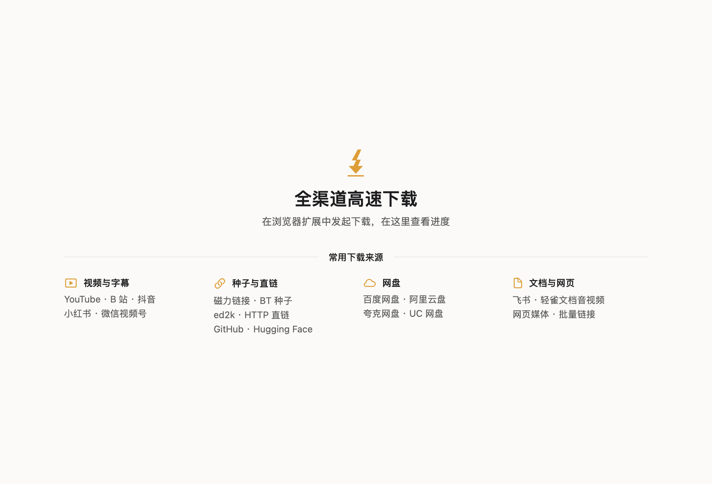
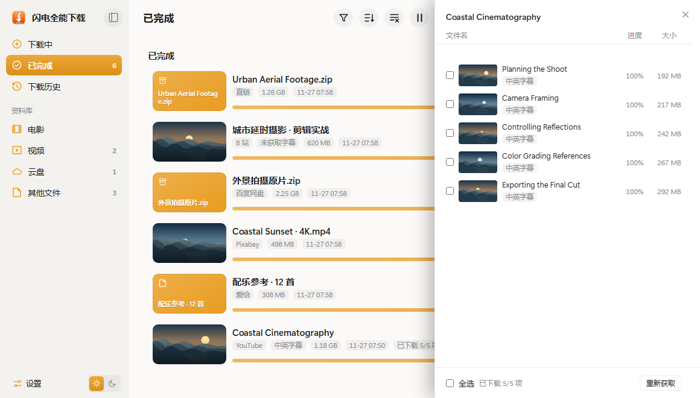

<!-- 搜索关键词：下载工具, 全能下载器, Mac 下载工具, macOS 下载器, Windows 下载器, 磁力下载, 种子下载, BT 下载, ed2k, 迅雷替代, Mac 迅雷, IDM 替代, 下载没速度, 磁力 0 速度, 云盘离线, PikPak, 视频下载, 网页音频下载, 网页音视频嗅探, B 站下载, 抖音下载, 小红书下载, 网盘直链, yt-dlp 图形界面, MCP 下载, download manager, macos download manager, windows download manager, magnet downloader, torrent client, ed2k client, audio sniffer, yt-dlp gui -->
<div align="center">


# 闪电全能下载 · Shandian Download Manager

<strong>macOS 与 Windows 的开源下载管理器</strong>

从网页视频、双语字幕、网盘和文档附件，到磁力、BT、ed2k 和大文件直链，统一下载、续传和归档。

[macOS Apple 芯片](https://github.com/chenmozhe008/shandian-download/releases/download/v0.22.8/Shandian-0.22.8-AppleSilicon.zip) · [macOS Intel](https://github.com/chenmozhe008/shandian-download/releases/download/v0.22.8/Shandian-0.22.8-Intel.zip) · [下载 Windows 版（x64）](https://github.com/cgeek-dev/shandian-download/releases/latest) · [视频与字幕](#视频与字幕) · [网盘下载](#网盘下载) · [更新记录](https://github.com/chenmozhe008/shandian-download/releases/latest)

简体中文 | [English](README.en.md)

[](https://github.com/chenmozhe008/shandian-download/releases/latest)


<sub>25 秒 macOS 流程演示。使用模拟操作和示例数据，等待过程已加速。</sub>

[高清演示视频（MP4）](https://raw.githubusercontent.com/chenmozhe008/shandian-download/master/docs/images/demo-download.mp4)

</div>

macOS 版由本仓库维护，Windows 版由 [@cgeek-dev](https://github.com/cgeek-dev) 独立开发与维护。下载内核基于定制版 [Gopeed](https://github.com/GopeedLab/gopeed)，视频平台解析由 [yt-dlp](https://github.com/yt-dlp/yt-dlp) 提供支持。

## 视频与字幕

macOS 版的 YouTube 任务可选画质、仅下载音频，以及是否获取字幕。用 Chrome / Edge 完整版扩展可把 YouTube 视频交给闪电。保留新建任务确认窗口，就能逐条选择 720P 和字幕处理方式。

| 选项 | 结果 |
| --- | --- |
| 只下载原字幕 | 默认选项。优先使用可用的源语言字幕，支持本地结构修整，无需 AI |
| AI 翻译成中文 | 按设置生成中外双语 ASS 或简体中文 SRT，供播放器加载或剪辑使用 |

可使用本机 Ollama 或已配置的 API。在本机运行时，速度取决于模型和电脑性能。选在线 API 时，字幕文本才会发送给对应服务商，可能消耗额度或产生费用。字幕不可用或处理失败时，已保存的视频仍可打开。YouTube 可用画质和字幕轨由平台决定。

<details>
<summary>查看 macOS 首页</summary>

<div align="center">


<sub>macOS 空闲首页 · 浏览器扩展发起下载，闪电统一管理</sub>
</div>


</details>

## 网盘下载

| 来源 | macOS 使用方式 |
| --- | --- |
| 百度网盘分享 | 粘贴链接与提取码，首次按提示安装并授权百度官方 bdpan。下载校验完成后自动清理本次云端临时转存 |
| 阿里云盘 | 用 Chrome / Edge **完整版扩展 1.12.1**，在个人网盘勾选文件后点「闪电下载」。分享先保存到自己的网盘 |
| 夸克网盘、UC 网盘 | 用同一完整版扩展，在已登录的网盘中勾选下载。分享页能否直下取决于权限，页面要求保存时先转存 |
| 已获取的网盘直链 | 可直接粘贴 HTTP / HTTPS 下载链接，也可通过支持的工具发给闪电 |

下载权限、可用空间和转存条件取决于网盘服务。百度不允许把自己发出的分享转存回同一账号，可到个人网盘找到原文件。[Windows 版](#windows-版)有独立的网盘解析和账号流程，详见其使用说明。

## Windows 版

Windows 版由 [@cgeek-dev](https://github.com/cgeek-dev) 基于本项目独立开发与维护，支持 Windows 10 / 11（64 位，简体中文界面），源码位于本仓库 [`windows/`](windows/) 目录。

- **下载安装包**：[Windows 最新版下载](https://github.com/cgeek-dev/shandian-download/releases/latest)（提供完整安装器与免安装便携版，支持应用内自动更新）
- **使用与构建说明**：[windows/README.md](windows/README.md) · [更新记录](windows/CHANGELOG.md)

Windows **0.2.23** 支持独立的下载队列、合集管理和多网盘解析。YouTube 任务可选择字幕语言和格式，以本机 Ollama 校对或翻译。双语 ASS 可预览和调整字体、字号、描边、背景及位置，合集内也能查看每集的字幕状态。

| 中英双语 ASS 样式预览 | 合集与字幕状态 |
| --- | --- |
|  |  |

<details>
<summary>查看 Windows 下载队列与波形试听</summary>

<div align="center">


<sub>Windows 下载队列 · 视频、合集、网盘和其他文件集中管理</sub>
</div>


</details>

Windows 界面图来自 [@cgeek-dev 的 Windows 0.2.23 发布源码](https://github.com/cgeek-dev/shandian-download/tree/v0.2.23-windows/docs/images)。Windows 的发布和问题反馈由该项目维护。

## 侦测网页音视频与批量链接

- **播放一下，侦测并试听。** 在 Chrome / Edge 完整版扩展中开启音视频侦测，再播放网页中的内容。侦测到的录音可以看波形、先试听，再按需保存。
- **勾选文档附件，保留原名。** 扫描飞书或轻雀文档后，可勾选原始音视频，多选时统一存到同一个文件夹。飞书首次需要官方 CLI 授权。
- **一页链接，批量交给闪电。** 用扩展抓取页面里的可下载链接，勾选所需文件后一次加入任务列表。

## BT 卡在 0% 时自动换路

BT 或磁力任务长期无进展时，可交给已配置的备用通道。备用通道下完后，闪电再把文件取回本机。具体条件见[云盘离线与自动换路](#云盘离线与自动换路可选)。


<sub>操作模拟，过程已加速。能否下载及实际速度取决于资源和所用服务。</sub>

## 支持的下载类型

| 类型 | 添加方式 |
| --- | --- |
| 磁力链接、种子文件、ed2k | 复制链接后粘贴，或将种子文件拖入窗口 |
| HTTP / HTTPS 文件 | 复制链接后粘贴；安装浏览器扩展后自动接管网页下载 |
| YouTube、X、哔哩哔哩、微博 | 复制视频页链接后粘贴 |
| 豆瓣电影预告片 | 复制预告片页面链接后粘贴 |
| 微信视频号 | 粘贴分享链接，按指引在已登录的腾讯元宝页面使用完整版浏览器扩展下载 |
| 网页音视频 | 在完整版浏览器扩展中开启「侦测本页面音视频」，播放即可捕获并支持波形试听、原名保存与多选保存到文件夹 |
| 网页文件直链（MP4、MP3、ZIP 等） | 用完整版扩展「批量抓取页面下载链接」，按需勾选并批量添加 |
| 抖音、小红书、新片场 | 在浏览器中打开视频页，通过完整版浏览器扩展发送 |
| 百度网盘分享 | 粘贴分享链接和提取码。安装并授权[百度官方 bdpan](https://github.com/baidu-netdisk/bdpan-storage) 后可选择「用闪电下载」，也可以打开官方分享页 |
| 阿里云盘、夸克网盘、UC 网盘 | 在登录后的个人网盘中勾选文件，点完整版扩展提供的「闪电下载」 |
| GitHub / Hugging Face 公开文件 | 粘贴链接，自动测速选择可用镜像；中途失败可换站并尝试续传 |
| 飞书文档音视频 | 打开文档并点击完整版扩展，勾选可下载附件。也可将文档链接粘贴到闪电下载整篇附件。需安装并授权飞书官方 lark-cli |
| 轻雀文档音视频 | 在完整版扩展点「扫描当前页面」，勾选可访问的原始音视频附件 |
| 网盘直链 | 可通过 [LinkSwift](https://github.com/hmjz100/LinkSwift) 获取直链后发送 |

常规视频站默认选择最高可用画质，优先 H.264 与 AAC；抖音、小红书支持下载无平台水印的视频。视频号使用元宝返回的可用视频，暂不提供画质和字幕选择，需要登录腾讯元宝；视频号分享链接只在用户点击解析后提交给腾讯。具体平台、视频和画质能否下载取决于网站及账号权限。

## 下载性能

- <strong>磁力任务启动快</strong>：每次启动时从公开列表合并获取最新 tracker，并固定 BT 监听端口以便其他节点连入。使用公开片源测试，磁力链接 5–18 秒开始下载
- <strong>HTTP 多连接下载</strong>：大文件分段并行下载，每段不小于 20 MB；服务器返回限流（429）或临时错误（5xx）时自动退避重试，连续 3 分钟无进展才判定失败，避免任务长期停在「下载中」
- <strong>视频分片并发</strong>：YouTube 等平台按 4 路分片并发下载，测试中速度由 1.4–1.6 MiB/s 提升至 3.4–4.1 MiB/s
- <strong>冷门资源云端离线（可选）</strong>：BT 网络中无人分享的资源，可自动交由 PikPak 服务器先行下载，取回本地后清理云端副本
- <strong>按域名分流代理</strong>：读取系统代理设置，境外站点经代理下载，国内站点与 BT 任务直连，无需手动切换

- **GitHub / Hugging Face 公开文件**可测速选择镜像，下载中断时可改用其他镜像尝试续传。

> 以上数据为作者在本机网络环境下的实测结果，实际速度取决于网络条件与资源热度。

## 下载管理与资料库

<div align="center">

</div>

- <strong>资料库自动分类</strong>：任务按电影、视频、网盘、其他文件归类，已完成的影片以画面缩略图展示，双击即可打开
- <strong>边下边播</strong>：电影下载过程中可直接播放，拖动进度条时优先下载对应片段
- <strong>断点续传</strong>：关闭窗口后下载在后台继续，菜单栏显示实时速度；退出应用后再次打开，未完成的任务自动恢复，无需重新校验
- <strong>剪贴板监测</strong>：在其他应用中复制下载链接时，屏幕右上角弹出提示，点击即可开始下载
- <strong>下载设置</strong>：可分别设置磁力 / 种子、视频平台、其他文件的保存位置，以及同时下载数与全局限速
- <strong>回收站</strong>：移除的任务保留记录，可随时重新下载
- <strong>完成提醒</strong>：下载完成时发送系统通知并播放提示音
- <strong>定时下载</strong>：可只在指定时段下载，时段外自动暂停，到点自动继续
- <strong>中英双语</strong>：设置中可选跟随系统、简体中文或 English，整个界面只用一种语言；浏览器扩展跟随浏览器语言
- <strong>诊断导出</strong>：反馈问题时可导出诊断信息，内容不含路径、片名、链接和令牌
- <strong>一键更新</strong>：有新版本时侧栏「关于」右侧显示「立即升级」，点按后在应用内下载与本机芯片对应的安装包、校验并自动替换，完成后重新打开，未完成的任务自动继续

## 系统要求

- **macOS**：macOS 14 或更新版本（分别提供 Apple 芯片与 Intel 安装包）；下载视频平台内容需要 `ffmpeg`
- **Windows**：Windows 10 / 11（64 位 x64，简体中文界面），由 [@cgeek-dev](https://github.com/cgeek-dev) 独立开发与维护，详见下方 [Windows 版](#windows-版)

## 安装（macOS）

### 方式一：命令行安装（推荐）

已安装 [Homebrew](https://brew.sh) 时：

```bash
brew install --cask chenmozhe008/shandian/shandian
```

下载视频平台内容还需要 `brew install ffmpeg`。

没有 Homebrew 时，打开「终端」，粘贴以下命令并回车：

```bash
curl -fsSL https://raw.githubusercontent.com/chenmozhe008/shandian-download/master/script/install.sh | bash
```

脚本会下载最新版本，发布附件提供 SHA-256 时先核验下载文件，再安装到「应用程序」文件夹并打开，同时跳过系统的「无法验证开发者」拦截；如已安装 [Homebrew](https://brew.sh)，会一并安装 ffmpeg。再次运行同一命令即可更新；0.18.0 起也可以在应用内一键更新。

### 方式二：通过 AI 助手安装

使用 Claude Code、Codex、WorkBuddy 等 AI 助手时，可将以下内容发送给它：

> 请帮我安装「闪电全能下载」（https://github.com/chenmozhe008/shandian-download）：在终端运行 `curl -fsSL https://raw.githubusercontent.com/chenmozhe008/shandian-download/master/script/install.sh | bash`。装好后，一步步告诉我怎么在浏览器里装它的扩展。

<details>
<summary>给 AI 助手的说明</summary>

- 安装脚本 `script/install.sh` 可以重复运行（覆盖旧版，旧版移到废纸篓）；要求 macOS 14+，按芯片自动选择 AppleSilicon / Intel 安装包。加 `-s -- --no-ffmpeg` 可不装 ffmpeg
- 浏览器不允许程序自动安装扩展，这一步必须由用户操作：扩展文件夹在 `~/Library/Application Support/ShandianDownload/BrowserExtension`（App 第一次打开时生成）；用 `open -a "Google Chrome" chrome://extensions`（Edge 为 `edge://extensions`）打开扩展管理页，`open "$HOME/Library/Application Support/ShandianDownload"` 显示文件夹，再引导用户打开「开发者模式」、把 `BrowserExtension` 文件夹拖进页面
- 把链接交给 App 下载：`open -g "shandian://add?url=<URL 编码后的链接>"`（可带多个 url；加 `confirm=0` 不弹确认框）

</details>

### 方式三：手动安装

1. 在 [Releases](../../releases) 按芯片下载安装包：Apple 芯片（M 系列）选 `Shandian-版本号-AppleSilicon.zip`，Intel 处理器选 `Shandian-版本号-Intel.zip`（不确定时点屏幕左上角苹果菜单 →「关于本机」，看「芯片」或「处理器」一栏）。解压后将应用拖入「应用程序」
2. 首次打开时，系统会提示「无法验证开发者」（本应用未经过 Apple 公证）。点击「完成」，前往「系统设置 → 隐私与安全性」，在页面下方点击「仍要打开」。此后可正常打开
3. 如需下载视频平台内容，请安装 ffmpeg：已安装 Homebrew 时，在终端运行 `brew install ffmpeg`

## 浏览器扩展

扩展有两个版本，都支持 Chrome 与 Edge，按需要选择一个即可：

| | 完整版（功能更多，推荐） | 商店版（安装简单） |
|---|---|---|
| 安装方式 | 开启开发者模式后手动安装 | 在浏览器商店搜索，一键安装 |
| 更新方式 | 随应用自动更新 | 由浏览器商店更新 |
| 右键发送压缩包、文档、安装包链接 | ✓ | ✓ |
| 网页上点击下载时自动接管 | ✓ | ✓（0.2.0 起，5 MB 以上的文件） |
| 磁力、ed2k 链接 | ✓ | — |
| 点击种子文件直接交给应用 | ✓ | ✓（0.2.0 起） |
| 视频网站上悬停视频出现「下载」按钮 | ✓ | — |
| 抖音、小红书、新片场等视频 | ✓ | — |
| 微信视频号 | ✓ | — |
| 网页音视频侦测、试听与批量保存 | ✓ | — |
| 飞书、轻雀文档音视频扫描与多选下载 | ✓ | — |
| 批量抓取页面中的链接 | ✓ | — |
| 需要登录的下载链接 | ✓ | 可能无法使用 |
| 浏览器权限 | 需要访问所有网站、Cookie 和下载 | 仅右键菜单、下载、本地设置和连接本应用 |

### 商店版

在 Chrome 网上应用店或 Edge 加载项商店搜索「Shandian Download Manager」，或直接打开：[Chrome](https://chromewebstore.google.com/detail/achpnnoffkoeomkmofbcjpnmifaeanjg) · [Edge](https://microsoftedge.microsoft.com/addons/detail/onnpjcddpnfmaahjjdcibcofebfgopei)。

安装后右键点击支持的文件链接，选择「发送到闪电」。0.2.0 起，网页上开始的 5 MB 以上的文件下载也会自动交给闪电，可在扩展弹窗中关闭；闪电没打开时由浏览器照常下载。使用时需要打开闪电全能下载（0.18.24 或更新版本）。

### 完整版

1. 在菜单栏选择「闪电全能下载 → 浏览器扩展…」，在对应浏览器一行点击「手动安装」，会同时打开扩展管理页和扩展文件夹
2. 在扩展管理页开启「开发者模式」：Chrome 位于页面右上角，Edge 位于左侧栏
3. 将 `BrowserExtension` 文件夹拖入浏览器的扩展管理页

安装完成后，窗口中会显示「已连接」。

<strong>下载视频</strong>：打开视频页，点击浏览器工具栏中的闪电全能下载图标，再点击「下载这个视频」；也可在视频画面上点按右键，选择「用闪电全能下载」。

<strong>侦测网页音视频</strong>：在包含音频或视频的网页点开扩展，点击「侦测本页面音视频」后播放素材，图标会显示已捕获数量角标。重新点开扩展即可按素材原名试听波形进度、单条下载，或勾选多条可直接保存的文件，统一下载到一个文件夹。

<strong>批量下载网页文件</strong>：在支持的网页点「批量抓取页面下载链接」，可勾选页面上带有受支持后缀的直链，例如 MP4、MP3、ZIP，也可勾选磁力和 ed2k 链接。文档中需要点播放才请求的视频或音频，可使用「侦测本页面音视频」。下载取决于网页实际提供的资源和账号权限。

#### 文档音视频下载

<strong>飞书文档和知识库</strong>：打开文档并点完整版扩展，闪电会读取整篇文档的原始音视频附件，显示文件名、大小和已选数量（默认全选，可取消不需要的条目）；也可以直接把文档链接粘贴到闪电里下载整篇附件。首次需安装并授权[飞书官方 lark-cli](https://github.com/larksuite/cli)，账号需有文档访问和附件下载权限。

<strong>轻雀文档</strong>：打开有访问权限的文档，在完整版扩展点「扫描当前页面」，可列出尚未滚动到的原始音视频附件，一次最多识别 100 项。

单选直接保存原文件，多选统一保存到文档文件夹。批量任务会显示已完成文件数和速度，继续或重试时可复用已校验的文件。

## 给 AI 工具用（MCP）

应用内置 MCP 服务，AI 工具可以提交下载、查看进度、暂停和继续；只在本机运行，不能删除任务或文件。在「设置 → AI 工具」选择工具，复制对应的命令或配置：

| 工具 | 接入方式 |
|---|---|
| Claude Code、Codex、Gemini CLI | 在终端运行复制的命令 |
| ChatGPT 桌面版 | 设置 → MCP servers → Add server，类型选 STDIO，命令粘贴复制的路径 |
| Claude Desktop | 设置 → 开发者 → 编辑配置，粘贴配置 |
| Cursor | 粘贴到 `~/.cursor/mcp.json` |
| Trae | 设置 → MCP → 手动添加 |
| Windsurf | 在 Cascade 的 MCP 菜单打开配置文件 |
| VS Code | 命令面板运行 `MCP: Open User Configuration` |
| 其他支持 MCP 的工具 | 使用通用的 `mcpServers` 配置 |

## 云盘离线与自动换路（可选）

<strong>用途</strong>：部分资源在 BT 网络中几乎无人分享，下载速度长期为 0。此时可自动转交本机迅雷或 PikPak 云盘处理：由云端服务器先完成下载，再拉回本地并清理云端副本。

1. 注册 [PikPak](https://mypikpak.com) 账号，免费账号即可
2. 在「设置 → 下载加速」中登录：点击「在窗口里登录…」，在 PikPak 官方登录页登录（支持 Google、Apple 等方式）；如浏览器中已登录 PikPak，也可点击「从浏览器关联」（需先安装浏览器扩展），之后请关闭浏览器中的 PikPak 页面，否则可能使这边的登录失效
3. 关联后默认开启自动转交：磁力、种子 1 分钟没有速度，或 3 分钟几乎没有速度时自动交给云盘；下载进度过半或应用刚启动时不会自动转交。也可以对任务点按右键，选择「交给云盘离线」，或在设置中关闭自动转交

免费账号每天约 3 次、20 GB 额度，云盘空间 6 GB，提示和设置中会显示当天已用次数。文件取回本地并核对大小后，云端副本会被彻底删除，文件夹任务中未取回的说明、花絮等也一并清理；云盘空间不足时，还会清理回收站中离线任务留下的文件。可在设置中关闭自动清理。PikPak 未提供公开接口，本功能参照开源项目对接其网页版，PikPak 改版时可能暂时不可用。

云盘目录达到 500 项或返回分页时，应用暂不拉回该目录，并保留云端文件，避免遗漏内容。

## 常见问题

<strong>打开时提示「无法验证开发者」</strong>：参见「方式三」第 2 步，或使用「方式一」的命令安装。

<strong>YouTube 无法下载</strong>：需要科学上网，闪电全能下载会跟随系统代理设置。

<strong>检查更新或升级失败</strong>：更新放在 GitHub 上，需要科学上网。请检查网络设置，或到发布页手动下载。

<strong>视频下载后没有声音，或提示合并失败</strong>：未安装 ffmpeg，在终端运行 `brew install ffmpeg`。

<strong>云盘离线提示登录已失效</strong>：点击提示中的「重新关联」，或在「设置 → 下载加速」中点击「在窗口里登录…」，然后重新提交任务。从浏览器关联时，浏览器与应用共用一份登录，浏览器页面开着可能使应用的登录失效，建议使用窗口登录。云盘提交失败时，应用会恢复原下载任务。

<strong>闪电操作不了迅雷（要手动点立即下载或暂停）</strong>：在「系统设置 → 隐私与安全性 → 辅助功能」里允许闪电全能下载；开关已打开仍不行时，请关掉再重新打开。

<strong>云盘离线无法连接，或从云盘拉回速度很慢</strong>：PikPak 需要科学上网，请检查网络设置。

<strong>文件保存在哪里</strong>：磁力、种子、ed2k、视频平台内容和其他文件默认保存在「下载」，均可在设置中修改。

## 从源码构建

```bash
swift build -c release                # 只编译 App
./script/build_engine.sh              # 编译下载内核（需要 Go，见脚本里的路径说明）
./script/build_app.sh package         # 打包成 dist/闪电全能下载.app
```

下载内核为打过补丁的 [Gopeed](https://github.com/GopeedLab/gopeed) v1.9.3，补丁位于 `engine/shandian-gopeed-v1.9.3.patch`，包含：重启后免重新校验、全局限速、边下边播、服务器限流时退避重试等。`build_engine.sh` 与 `build_app.sh` 中的路径为作者本机环境，构建前请按实际环境修改。

## 致谢

- [@cgeek-dev](https://github.com/cgeek-dev)：Windows 版开发与长期维护
- [Gopeed](https://github.com/GopeedLab/gopeed)（GPL-3.0）：下载内核
- [yt-dlp](https://github.com/yt-dlp/yt-dlp)（Unlicense）：视频平台下载
- [FFmpeg](https://ffmpeg.org)：音视频合并

## 声明

本软件仅供个人下载有权获取的内容，请遵守各网站的服务条款及当地法律法规。README 截图使用演示数据。

## 许可证

[GPL-3.0](LICENSE)
