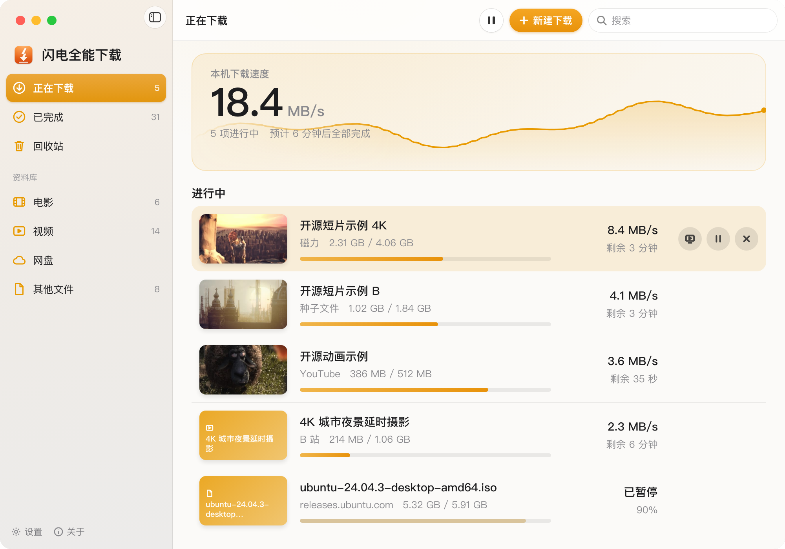
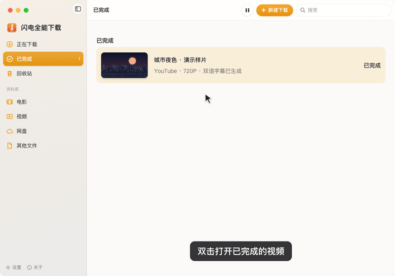
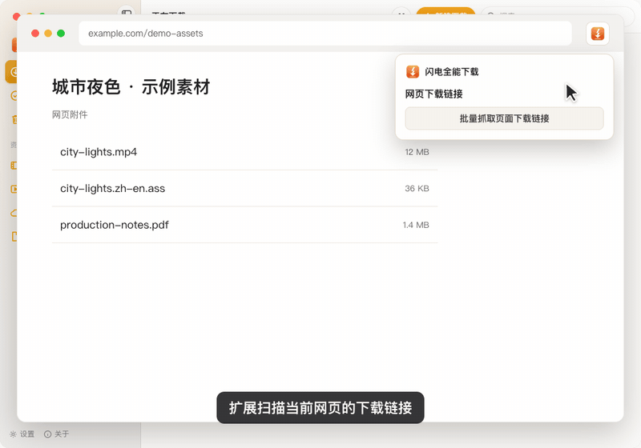
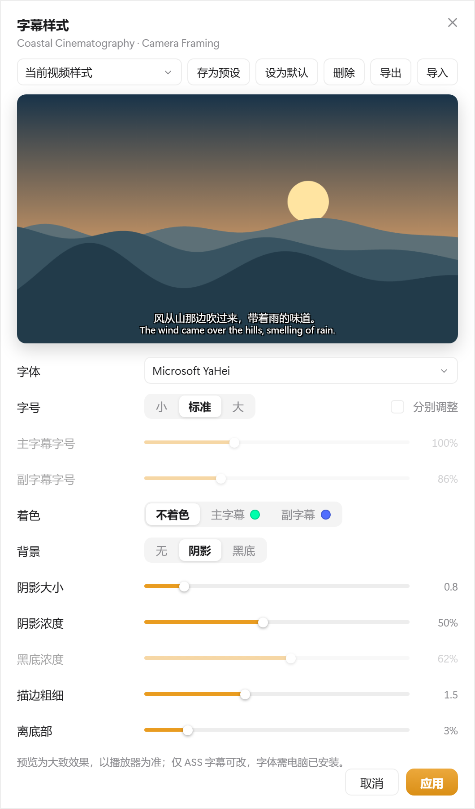
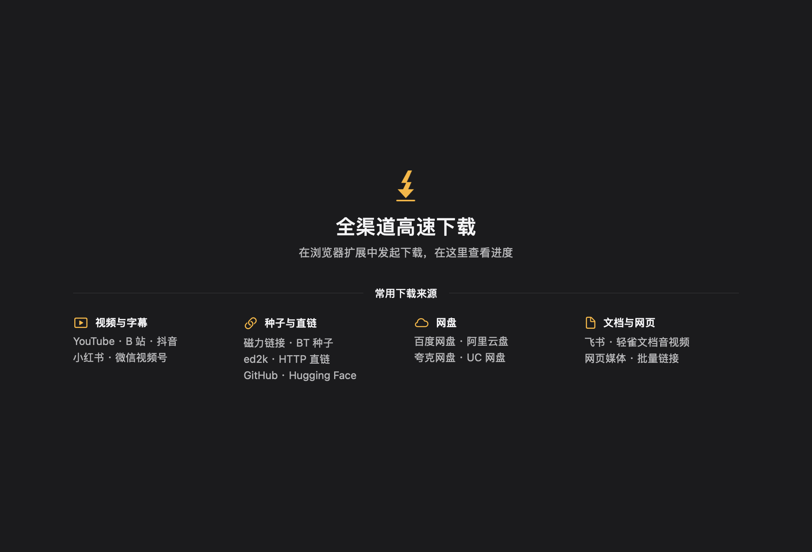
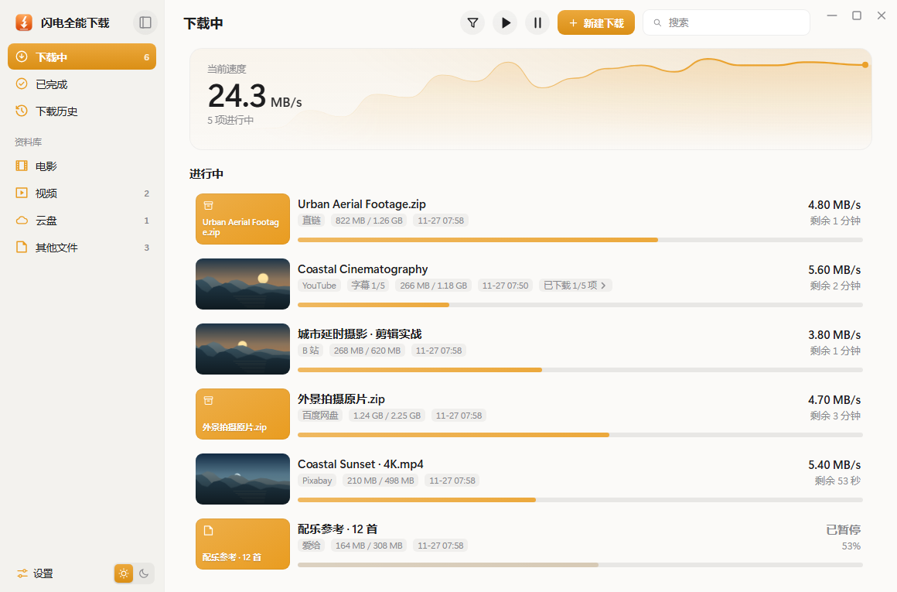
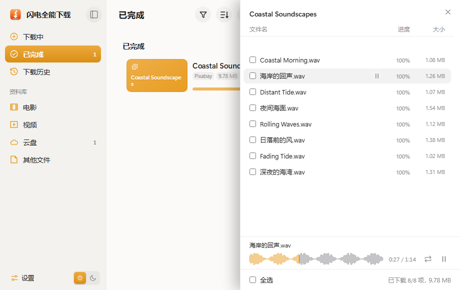

<!-- 搜索关键词：下载工具, 全能下载器, Mac 下载工具, macOS 下载器, Windows 下载器, 磁力下载, 种子下载, BT 下载, ed2k, 迅雷替代, Mac 迅雷, IDM 替代, 下载没速度, 磁力 0 速度, 云盘离线, PikPak, 视频下载, 双语字幕, ASS 字幕, 网页音频下载, 网页音视频嗅探, B 站下载, YouTube 下载, 抖音下载, 小红书下载, 百度网盘, 阿里云盘, 夸克网盘, UC 网盘, GitHub 加速, Hugging Face 加速, 飞书文档, yt-dlp 图形界面, MCP 下载, download manager, macos download manager, windows download manager, magnet downloader, torrent client, ed2k client, yt-dlp gui -->
<div align="center">


# 闪电全能下载 · Shandian Download Manager

**免费开源、无广告的全渠道高速下载工具（macOS & Windows）**

磁力 / BT / ed2k、视频与双语字幕、四大网盘、飞书文档与 GitHub / Hugging Face 加速，一个窗口全速收齐。

[**下载 Mac（Apple 芯片）**](https://github.com/chenmozhe008/shandian-download/releases/download/v0.22.8/Shandian-0.22.8-AppleSilicon.zip) · [**下载 Mac（Intel）**](https://github.com/chenmozhe008/shandian-download/releases/download/v0.22.8/Shandian-0.22.8-Intel.zip) · [**下载 Windows（x64）**](https://github.com/cgeek-dev/shandian-download/releases/download/v0.2.23-windows/Shandian-0.2.23-Windows-x64-setup.exe) · [快速安装](#快速安装) · [English](README.en.md)

[](https://github.com/chenmozhe008/shandian-download/releases/latest)
[](LICENSE)


<br>



</div>

---

## 核心亮点

- **一个窗口顶五个工具**：统一管理磁力、BT 种子、ed2k、HTTP 直链、主流视频站、百度 / 阿里 / 夸克 / UC 网盘、飞书与轻雀文档音视频，以及 GitHub / Hugging Face 开源资源。
- **多连接提速，冷门 BT 不卡 0%**：HTTP 大文件多连接分段、YouTube 4 路分片并发、GitHub / Hugging Face 自动测速优选镜像并断线换站续传；BT 长期无速度时自动换路本机迅雷或 PikPak 云盘离线，下完取回并清理云端副本。
- **外语视频一键生成双语字幕**：支持最高 4K 与仅音频，勾选字幕自动建独立文件夹；AI 模式先做语义重断句与全片术语统一，输出带影视字号比例的 `.ass` 双语字幕，双击即看、不与原英文轨冲突。
- **免装网盘客户端 + 网页音视频嗅探**：不装臃肿桌面端即可高速下载四大网盘；搭配 Chrome / Edge 扩展，支持网页音视频实时侦测与波形试听、页面直链批量抓取，以及飞书 / 轻雀文档原始附件批量保存。
- **双端原生体验，内置本机 MCP**：macOS 采用 SwiftUI 原生开发，Windows 由 [@cgeek-dev](https://github.com/cgeek-dev) 基于 Tauri 独立维护；支持边下边播、自动分类资料库、定时下载与一键更新，内置本机 MCP 可供 Claude Code、Codex、Cursor、ChatGPT 桌面版直接调用。

---

## 快速安装

### macOS（14 及以上）

**Homebrew 安装（推荐）**

```bash
brew install --cask chenmozhe008/shandian/shandian
brew install ffmpeg   # 下载视频网站合并音视频所需
```

**无 Homebrew 一键脚本**（自动按芯片下载、校验 SHA-256、安装并跳过首次拦截）

```bash
curl -fsSL https://raw.githubusercontent.com/chenmozhe008/shandian-download/master/script/install.sh | bash
```

<details>
<summary>手动下载安装 / 通过 AI 助手安装</summary>

#### 手动安装
1. 按芯片下载安装包：Apple 芯片（M 系列）选 [AppleSilicon.zip](https://github.com/chenmozhe008/shandian-download/releases/download/v0.22.8/Shandian-0.22.8-AppleSilicon.zip)，Intel 处理器选 [Intel.zip](https://github.com/chenmozhe008/shandian-download/releases/download/v0.22.8/Shandian-0.22.8-Intel.zip)，解压后拖入「应用程序」。
2. 首次打开若提示「无法验证开发者」（开源软件未公证），点「完成」后前往「系统设置 → 隐私与安全性」底部点「仍要打开」。
3. 下载视频网站内容需要 `ffmpeg`（`brew install ffmpeg`）。

#### 让 Claude Code / Codex / WorkBuddy 帮你装
直接复制下面这段发给你的 AI 助手：

> 请帮我安装「闪电全能下载」（https://github.com/chenmozhe008/shandian-download）：在终端运行 `curl -fsSL https://raw.githubusercontent.com/chenmozhe008/shandian-download/master/script/install.sh | bash`。装好后，一步步告诉我怎么在浏览器里装它的扩展。

</details>

### Windows（10 / 11 x64）

Windows 版由 [@cgeek-dev](https://github.com/cgeek-dev) 独立开发与维护，源码位于 [`windows/`](windows/) 目录：

- **直接下载**：[Windows 安装器（v0.2.23）](https://github.com/cgeek-dev/shandian-download/releases/download/v0.2.23-windows/Shandian-0.2.23-Windows-x64-setup.exe) · [免安装便携版](https://github.com/cgeek-dev/shandian-download/releases/download/v0.2.23-windows/Shandian-0.2.23-Windows-x64-Portable.zip) · [全部发布](https://github.com/cgeek-dev/shandian-download/releases/latest)
- **说明文档**：[windows/README.md](windows/README.md) · [windows/CHANGELOG.md](windows/CHANGELOG.md)

### Chrome / Edge 浏览器扩展

- **完整版（推荐，支持视频、网盘、文档与嗅探）**：打开应用菜单「闪电全能下载 → 浏览器扩展…」，点击「手动安装」，在浏览器扩展页开启「开发者模式」后将 `BrowserExtension` 文件夹拖入即可，随应用自动更新。
- **商店版（一键安装，适合普通直链与种子接管）**：[Chrome 商店](https://chromewebstore.google.com/detail/achpnnoffkoeomkmofbcjpnmifaeanjg) · [Edge 商店](https://microsoftedge.microsoft.com/addons/detail/onnpjcddpnfmaahjjdcibcofebfgopei)

<details>
<summary>查看完整版与商店版权限与功能对比</summary>

| 能力 | 完整版（推荐） | 商店版 |
| --- | :---: | :---: |
| 右键发送文件链接 / 自动接管网页下载（5 MB+） | ✓ | ✓ |
| 点击种子文件直接交给应用 | ✓ | ✓ |
| 磁力、ed2k 链接接管 | ✓ | — |
| 视频页悬浮「下载」按钮（YouTube / 抖音 / 小红书 / 新片场 / 视频号） | ✓ | — |
| 阿里云盘 / 夸克网盘 / UC 网盘页面注入「闪电下载」 | ✓ | — |
| 网页音视频实时侦测、波形试听与批量保存 | ✓ | — |
| 飞书 / 轻雀文档原始音视频扫描与批量下载 | ✓ | — |
| 页面下载链接批量抓取 | ✓ | — |

</details>

---

## 核心场景一览

### 1. 视频下载与专业双语字幕

下载外语视频时自动建独立文件夹。选择 **AI 翻译（中外双语）** 后，程序先重组 YouTube 碎片断句、提取全片统一术语表，再按影视规范输出中文在上、英文在下的样式化 **`.ass` 双语字幕**（中文 52px 纯白细边、英文 34px 浅灰紧贴下方），并保留隐藏备份随时可恢复；目录内只保留最终这一份双语字幕，双击播放即得影院级观感。

<div align="center">


<sub>同一帧 03:31.70 实测对比：左侧原始自动字幕重叠且混杂标记，右侧为语义重断句并生成的中英双语 ASS（<a href="https://www.youtube.com/watch?v=X0yezvS3zR4&t=211s">示例视频</a>）</sub>
</div>

- 支持 **本机 Ollama（免费离线）** 及 DeepSeek、Kimi、通义千问、豆包、智谱 GLM、OpenAI、Gemini、Claude 等主流接口，测试连接零费用自动拉取最新模型列表。
- 也支持「只下载原字幕」（离线结构清理，不调用 AI）或「仅下载音频（M4A）」。

<details>
<summary>查看视频扩展操作与本地双语播放演示（动图 / 14 秒 MP4）</summary>

<div align="center">

<br>

<br>
<a href="https://raw.githubusercontent.com/chenmozhe008/shandian-download/master/docs/images/workflow-video.mp4">观看 14 秒完整操作视频（MP4）</a>
</div>

</details>

### 2. 冷门 BT 卡在 0% 自动换路

BT 或磁力任务在公网长期无人做种时，可自动转交本机迅雷或已关联的 PikPak 云盘离线，由云端完成下载后拉回原保存目录，核对无误后自动清理云端临时副本。

<div align="center">

</div>

### 3. 网页音视频嗅探、文档附件与批量抓链

- **网页音视频嗅探**：在扩展中开启侦测后播放网页内容，即可按原名捕获音视频，支持波形试听与多选打包保存。
- **飞书 / 轻雀文档音视频**：直接扫描整篇文档中的原始音视频附件，保留原文件名批量下载（多选自动归入同一文件夹）。
- **页面链接批量抓取**：一键提取当前页的 MP4、MP3、ZIP、磁力、ed2k 链接，勾选后批量入队。

<div align="center">

</div>

### 4. 自动分类资料库、边下边播与双端界面

下载任务按电影、视频、网盘、其他文件自动归类，支持**边下边播**、⌘/Shift 批量管理与合集文件抽屉；关闭窗口后台继续下载，菜单栏实时显示速度。

<div align="center">

</div>

| Windows 版 · 双语字幕样式预览 | Windows 版 · 合集与字幕状态 |
| :---: | :---: |
|  |  |

<details>
<summary>查看更多双端界面截图（macOS 浅/深色首页、Windows 下载队列与音频试听）</summary>

<div align="center">

<br>

<br>

<br>

</div>

</details>

---

## 支持的下载来源

| 分类 | 支持来源 | 使用方式 |
| --- | --- | --- |
| **视频与字幕** | YouTube、B 站、X、微博、豆瓣预告片、西瓜视频、快手、Vimeo | 复制视频链接按 ⌘V，或在浏览器扩展中一键发送；默认最高画质（优先 H.264 / AAC） |
| | 抖音、小红书、新片场 | 在浏览器打开视频页，点完整版扩展「下载这个视频」（支持无平台水印） |
| | 微信视频号 | 粘贴分享链接，按指引在已登录的腾讯元宝页面通过完整版扩展解析下载 |
| **网盘直下** | 百度网盘分享 | 粘贴分享链接与提取码，首次授权官方 [bdpan](https://github.com/baidu-netdisk/bdpan-storage) 后直接保存并自动清理云端转存 |
| | 阿里云盘、夸克网盘、UC 网盘 | 在网页版个人网盘勾选文件，点完整版扩展注入的「闪电下载」按钮直下 |
| | 其他网盘直链 | 支持直接粘贴直链，或配合 [LinkSwift](https://github.com/hmjz100/LinkSwift) 发送 |
| **协议与开源** | 磁力链接、BT 种子、ed2k、HTTP / HTTPS 直链 | 复制粘贴、拖入 `.torrent` 文件，或由扩展自动接管网页下载 |
| | GitHub / Hugging Face 公开文件 | 粘贴链接自动两轮测速优选镜像站，下载中断自动换站续传 |
| **文档与网页** | 飞书文档 / 知识库音视频 | 打开文档点完整版扩展，或直接粘贴文档链接批量下载（首次需授权官方 [lark-cli](https://github.com/larksuite/cli)） |
| | 轻雀文档音视频 | 打开文档后在完整版扩展点「扫描当前页面」，勾选原始附件批量保存 |
| | 网页音视频与批量直链 | 扩展开启「侦测本页面音视频」或「批量抓取页面下载链接」 |

---

## 给 AI 工具用（内置本机 MCP）

内置本机 MCP 服务（仅运行在你的电脑上，支持提交任务、查进度、暂停与继续，**不能删除任务或本地文件**）。在「设置 → AI 工具」中一键复制配置即可接入：

| AI 工具 | 接入方式 |
| --- | --- |
| **Claude Code / Codex / Gemini CLI** | 在终端执行复制的安装命令 |
| **ChatGPT 桌面版** | 设置 → MCP servers → Add server（STDIO），粘贴命令路径 |
| **Claude Desktop / Cursor / VS Code / Trae / Windsurf** | 在各自 MCP 配置文件中粘贴生成的 `mcpServers` JSON |

---

## 进阶说明与常见问题

<details>
<summary>下载性能与网络优化说明</summary>

- **磁力快速起速**：每次启动自动合并公开 tracker 列表并固定 BT 监听端口，实测公开片源 5–18 秒起速。
- **HTTP 多连接与容错**：大文件按 ≥ 20 MB 分段并行；遇限流（429）或临时错误（5xx）自动退避重试。
- **视频分片并发**：YouTube 等分片流采用 4 路并发，实测单任务速度提升约 2–3 倍。
- **按域名分流代理**：自动跟随系统代理，境外站点走代理，国内站点与 BT 流量直连。

</details>

<details>
<summary>PikPak 云盘离线与自动换路配置</summary>

1. 注册 [PikPak](https://mypikpak.com)（免费账号即可，每天约 3 次 / 20 GB 额度）。
2. 在「设置 → 下载加速」中点击「在窗口里登录…」（或已登录浏览器时点「从浏览器关联」）。
3. 关联后默认在磁力/种子连续 1–3 分钟无速度时自动转交，取回本地核对无误后自动清理云端副本；也可右键单个任务手动「交给云盘离线」。

</details>

<details>
<summary>常见问题（FAQ）</summary>

- **打开提示「无法验证开发者」**：用上方一键脚本安装可自动处理；手动下载请到「系统设置 → 隐私与安全性」点击「仍要打开」。
- **视频无声音或合并失败**：未安装 `ffmpeg`，终端运行 `brew install ffmpeg`。
- **YouTube / 更新 / PikPak 连不上**：这些服务位于境外，需开启系统代理（闪电会自动跟随）。
- **控制不了本机迅雷**：在「系统设置 → 隐私与安全性 → 辅助功能」勾选闪电全能下载（如已勾选请关掉重开一次）。
- **修改默认保存路径**：在「设置 → 通用」中可按磁力/种子、视频平台、其他文件分别指定目录。

</details>

<details>
<summary>从源码构建（macOS）</summary>

```bash
swift build -c release          # 编译 SwiftUI 应用
./script/build_engine.sh        # 编译定制版 Gopeed v1.9.3 内核（需 Go 环境）
./script/build_app.sh package   # 打包为 dist/闪电全能下载.app
```

下载内核补丁位于 `engine/shandian-gopeed-v1.9.3.patch`（含重启免重校验、全局限速、边下边播、限流退避重试等）。构建脚本中的路径请按本机环境调整。

</details>

---

## 致谢与声明

- **致谢**：[@cgeek-dev](https://github.com/cgeek-dev)（Windows 版开发与维护）· [Gopeed](https://github.com/GopeedLab/gopeed)（下载内核）· [yt-dlp](https://github.com/yt-dlp/yt-dlp)（视频解析）· [FFmpeg](https://ffmpeg.org)（音视频封装）
- **声明**：本软件仅供个人下载有权获取的内容，请遵守各平台服务条款与当地法律法规；实际下载权限、画质、字幕轨与速度取决于目标站点及网络条件；使用第三方在线 AI 字幕服务时，字幕文本会发送至你自行配置的服务商。README 截图与演示动图使用示例数据。
- **许可证**：[GPL-3.0](LICENSE)
